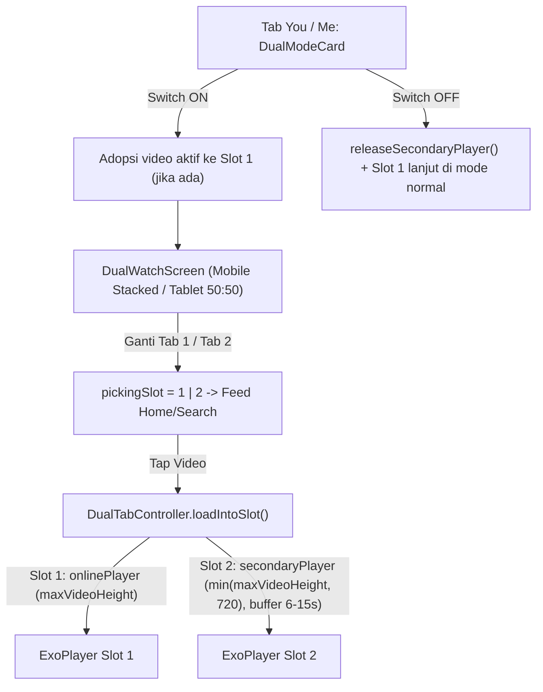

# Walkthrough: Dual Tab Mode (Putar 2 Video Bersamaan)

Implementasi **Dual Tab Mode (Fase 1–5)** dari [`PLAN_DUAL_TAB_MODE.md`](PLAN_DUAL_TAB_MODE.md) telah selesai di branch `feat/dual-tab-mode` (commit `863c88e`) dan lolos verifikasi **GitHub Actions CI**. Mode ini memungkinkan pemutaran 2 video YouTube sekaligus secara native menggunakan 2 instance `ExoPlayer` tanpa overhead browser engine.

> **Prototype Interaktif:** [`docs/prototypes/dual-mode-prototype.html`](docs/prototypes/dual-mode-prototype.html)

---

## Arsitektur & Alur Kerja

---

## Ringkasan Implementasi per Fase

### Fase 1: Preferensi & Pool 2 `ExoPlayer`
- **Preferensi Persisten**: Menambahkan `dualModeEnabled` dan `dualAudioPolicy` (`"focus"` / `"mix"`) ke `PlayerSettings` di [`PlayerControls.kt`](app/src/main/java/id/flufclip/player/PlayerControls.kt#L94-L143).
- **Buffer Slot 2 Lebih Kecil**: Menambahkan `secondaryLoadControl()` (buffer streaming `6_000`–`15_000` ms) di [`PlaybackNet.kt`](app/src/main/java/id/flufclip/player/PlaybackNet.kt#L122-L126) agar konsumsi RAM tambahan tetap rendah.
- **Pool Player & Audio Routing**: Di [`PlaybackService.kt`](app/src/main/java/id/flufclip/player/PlaybackService.kt#L54-L115), `PlaybackSessionHost` mengelola:
  - `obtainSecondaryPlayer()` dengan `DefaultRenderersFactory(...).setEnableDecoderFallback(true)`.
  - `releaseSecondaryPlayer()` yang juga dipanggil oleh `releaseOnlinePlayerForce()` dan `releaseOnlinePlayerIfIdle()`.
  - `applyDualAudioRouting()` yang memastikan **tepat 1 player** memegang `handleAudioFocus = true` (`focusedSlot`) dan mengatur `volume` (`0f` / `1f`) sesuai policy `"focus"` atau `"mix"`.

### Fase 2: State Holder & Stream Loader (`DualTabState.kt`)
- [`DualTabState.kt`](app/src/main/java/id/flufclip/player/DualTabState.kt#L21-L323) memisahkan state pure (`DualTabModel`) dari koordinator pemutar (`DualTabController`) yang memegang `PlaybackTrackState` terpisah untuk masing-masing slot:
  - `loadIntoSlot()` me-resolve `StreamInfo` lewat `VideoRepository.resolve()`, menerapkan cap tinggi video Slot 2 `minOf(maxVideoHeight, 720)`, dan mengonfigurasi audio pilihan.
  - `adoptSingleToSlot1()` memindahkan video normal yang sedang berjalan ke Slot 1 tanpa reload stream.
  - `handlePlayerErrorForFallback()` otomatis menurunkan resolusi Slot 2 (`480p` → `360p`) bila terjadi error decoder `MediaCodec`.
  - `saveSlot1BeforeShorts()` & `restoreSlot1AfterShorts()` menjaga posisi Slot 1 saat user membuka Shorts (yang memakai `onlinePlayer`).

### Fase 3: Entry Point di Screen `You / Me`
- Menambahkan `DualModeCard` tepat di bawah `ProfileHeaderSection` pada [`LibraryTab.kt`](app/src/main/java/id/flufclip/player/LibraryTab.kt#L87-L95) (definisi komponen di [`LibraryTab.kt`](app/src/main/java/id/flufclip/player/LibraryTab.kt#L426-L563)).
- Menyediakan switch ON/OFF, pilihan cepat policy audio (`Focus` / `Mix`), dan tombol **Buka Dual Player**.

### Fase 4: UI Dual Watch Adaptif (`DualWatchScreen.kt`)
- [`DualWatchScreen.kt`](app/src/main/java/id/flufclip/player/DualWatchScreen.kt#L56-L270) menyesuaikan tata letak berdasarkan `isWideWatchLayout(maxWidth, maxHeight)`:
  - **Android Mobile (Portrait)**: 2 viewport ditumpuk vertikal (`Slot 1` & `Slot 2`) dengan tinggi proporsional, diikuti drawer detail di bagian bawah dengan switcher `Detail Tab 1` / `Detail Tab 2` dan daftar *Up Next*.
  - **Tablet Landscape**: 2 kolom berdampingan 50:50 (`Side-by-Side`), masing-masing dengan viewport 16:9 penuh dan daftar *Up Next* scrollable independen di bawah videonya.
- **Workspace Bar**: Menyediakan tombol `Swap` (menukar mapping tampilan UI tanpa memindah instance `ExoPlayer`), toggle cepat `Focus Audio` / `Mix Audio`, dan tombol `Ganti Tab`.
- **Audio Focus Loss**: `DisposableEffect` pada kedua player ikut mem-pause slot lain jika slot yang sedang fokus kehilangan fokus audio (`PLAY_WHEN_READY_CHANGE_REASON_AUDIO_FOCUS_LOSS`).

### Fase 5: Integrasi Shell Aplikasi & Lifecycle
- **Inline Feed Playback**: `isInlinePlaybackEligible()` di [`InlineFeedPlayback.kt`](app/src/main/java/id/flufclip/player/InlineFeedPlayback.kt#L116-L118) mengembalikan `false` saat `dualModeEnabled == true` agar autoplay feed tidak merebut `onlinePlayer`.
- **PiP & Background Lifecycle**: Di [`MainActivity.kt`](app/src/main/java/id/flufclip/player/MainActivity.kt#L201-L226), `onStop()` selalu mem-pause Slot 2 sementara Slot 1 mengikuti `PlayerSettings.backgroundPlayback`; saat masuk mode PiP, hanya `focusedSlot` yang ditampilkan dan slot lain di-pause.
- **Routing & Picking Flow**: [`AppRoot.kt`](app/src/main/java/id/flufclip/player/AppRoot.kt#L1431-L1454) mengarahkan tap video di feed/search ke `DualTabController.loadIntoSlot()`, menampilkan banner indikator pemilihan slot di atas feed ([`AppRoot.kt`](app/src/main/java/id/flufclip/player/AppRoot.kt#L2150-L2176)), serta mengikat `MediaSession` ke `focusedSlot`.

---

## Verifikasi yang Sudah Dijalankan

| Cek | Target | Status | Referensi |
|---|---|---|---|
| Unit Test Dual State | `DualTabModelTest` (`focusSlot`, `applyAudioPolicy`, `toggleMute`, `swapSlots`, `startPicking`/`clearPicking`) | Lulus | [`DualTabModelTest.kt`](app/src/test/java/id/flufclip/player/DualTabModelTest.kt) |
| Unit Test Inline Guard | `InlineFeedPlaybackTest` (`dualModeEnabled = true` menonaktifkan inline) | Lulus | [`InlineFeedPlaybackTest.kt`](app/src/test/java/id/flufclip/player/InlineFeedPlaybackTest.kt#L156) |
| Android CI (GitHub Actions) | `cargo test --locked`, `build-android.sh`, `./gradlew --no-daemon :app:testDebugUnitTest :app:lintDebug :app:assembleDebug` | **Success** (4m32s) | [Run 44201502893](https://github.com/aqky29/PrismPlayer/actions/runs/44201502893) |

> Artifact APK debug (`prismplayer-debug-apk`) dan laporan test/lint (`test-and-lint-reports`) tersedia di halaman run GitHub Actions di atas.

---

## Pengujian Manual di Perangkat (Belum Dieksekusi)

Skenario runtime berikut belum dijalankan karena belum diuji langsung di perangkat Android fisik:
- Putar 2 video 720p bersamaan 2–3 menit dan ukur selisih RAM via `tdev sh "dumpsys meminfo id.flufclip.player"`.
- Verifikasi jeda otomatis saat telepon masuk / aplikasi audio lain mengambil audio focus.
- Verifikasi transisi rotasi Portrait ↔ Landscape, masuk/keluar Shorts, dan PiP di perangkat.
- Verifikasi fallback decoder perangkat keras pada perangkat RAM 4 GB.
