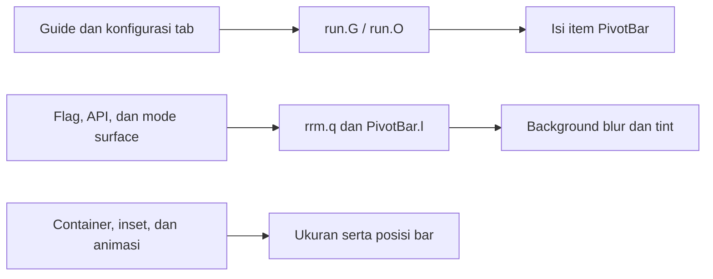

# Analisis frosted navigation YouTube dengan REA dan enam reviewer Luna

Pemeriksaan statis, 4 November 2026. Target asli: `referensi/youtube-21-43-523.apk`, SHA-256 `4410cf3e9a37db09e8bd0fcc2176d047284ce95192598e9118a5249194c1b84c`.

**Hasil utama:** implementasi frosted background pada PivotBar terkonfirmasi, dan beberapa bagian yang sebelumnya belum terurai sekarang sudah diperiksa langsung: offset area blur, pemanggilan redraw, mode `DARK_OPAQUE`, pemetaan atribut warna, perubahan tinggi bar, serta fungsi clipping RenderNode. Hubungan implementasi ini dengan kapsul floating lima tab pada gambar Android masih belum terbukti.

Tampilan yang didukung algoritma tersebut adalah latar navigasi berisi konten backdrop yang diburamkan dan ditimpa warna tema. Ikon dan label merupakan isi view navigasi di atas background itu. Bentuk akhir tetap bergantung pada layout, konfigurasi, dan state aplikasi yang benar-benar digunakan.

## Metode dan batas bukti

Enam reviewer independen dijalankan menggunakan model `gpt-6-luna`, `model_reasoning_effort="max"`, masing-masing dengan tugas berbeda dan akses baca saja. Keenamnya selesai dengan exit code 0. Mereka meninjau pemasangan/lifecycle, algoritma drawable, tema/foreground, geometri, model tab, serta Elements/Litho. [Manifest peluncuran dan penyelesaian](../.rea-out/frosted-navigation-2026-11-04-luna6/agent-completion-summary.json) dan [enam laporan reviewer](../.rea-out/frosted-navigation-2026-11-04-luna6/agents/) disimpan untuk pemeriksaan ulang.

Reviewer memakai artefak yang sudah tersedia. Koordinator melakukan probe REA tambahan secara berurutan dengan satu worker JADX; reviewer tidak membuka enam decompiler atau enam salinan APK.

Pemuatan metadata seluruh APK melalui REA melewati batas waktu 240 detik pada kuota CPU yang ditetapkan. Pemeriksaan berikutnya memakai APK turunan kecil berisi manifest biner asli dan satu DEX asli. Byte DEX dibandingkan langsung dengan anggota ZIP APK sumber; tidak ada instruksi DEX yang ditulis ulang. `resources.arsc` dan DEX lain sengaja tidak disertakan pada salinan ini. Identitas turunan berbeda dari APK asli dan dicatat dalam [provenance](../.rea-out/frosted-navigation-2026-11-04-luna6/dex-subsets/provenance.json).

Konsekuensinya, hasil REA terfokus membuktikan isi metode/field pada DEX yang disertakan. Ia tidak menjadi inventaris seluruh APK atau bukti lengkap semua incoming references. Pengaitan ke APK sumber diperkuat dengan pembacaan instruksi langsung dari APK asli: **27 body metode yang dipilih**, seluruhnya selesai ditelusuri sampai batas instruksinya. [Hasil probe byte DEX](../.rea-out/frosted-navigation-2026-11-04-luna6/dex-code-probes.json) mencatat hash anggota DEX, prototype, `code_item` offset, dan offset pemanggilan.

Kode aplikasi FlufPlay tidak diubah. Tidak dilakukan build, instalasi, pembukaan aplikasi referensi pada perangkat, pembacaan akun, atau perubahan flag runtime. Kata **terlihat** di laporan ini merujuk kode/resource yang diperiksa; **inferensi** merujuk kesimpulan dari algoritma; **belum diketahui** merujuk data yang belum diperoleh.

## 1. Pemasangan dan mode yang mengizinkan frosted

**Terlihat:** `rrb.run()` memerlukan flag `45630927=true` dan API Android minimal 31 sebelum memasang jalur frosted. Pemanggilan konfigurasi memakai fallback `false`. Flag `45647369` memilih pemasangan langsung atau melalui callback `rqv` kasus 0. Flag `45638138` memilih view sumber backdrop. Nilai efektif seluruh flag ini pada perangkat belum dibaca. [rrb.run](../.rea-out/navigation-ui-2026-11-04/rrb.java), [rqv.a](../.rea-out/navigation-ui-2026-11-04/rqv.java), [rrm.q](../.rea-out/navigation-ui-2026-11-04/rrm.java).

`rrm.q()` membuat **base drawable `auqu`**, dengan parameter alpha fallback `0.81`, lalu menyimpannya pada `PivotBar.p`. Pemasangan sebagai background juga memerlukan `PivotBar.q=true`.

**Temuan baru — identitas mode sekarang terverifikasi.** Smali `auux.<clinit>` memberikan pemetaan berikut:

| Field enum | Nama yang tertulis di DEX | Perilaku pada `run.M` |
|---|---|---|
| `auux.a` | `ACTIVITY_DEFAULT` | Memilih `PivotBar.Default`; state yang mengizinkan frosted bernilai true |
| `auux.b` | `DARK` | Memilih `PivotBar.Dark.DarkerPalette`; state yang mengizinkan frosted bernilai true |
| `auux.c` | `DARK_OPAQUE` | Memilih style gelap yang sama, tetapi state yang mengizinkan frosted bernilai false |

[Smali enum](../.rea-out/frosted-navigation-2026-11-04-luna6/new-code/014-auux-clinit.smali), [run.M](../.rea-out/navigation-ui-2026-11-04/run.java).

`PivotBar.l()` memakai state tersebut. Jika drawable sudah tersedia, state true dan API 31+ membuatnya diberi warna tema lalu dipasang. State false mengambil jalur background biasa sesuai style. Referensi `p` tetap disimpan sehingga perpindahan kembali dapat memakai drawable yang sama. Karena itu, memiliki kode blur dan flag startup yang aktif belum menjamin bar selalu terlihat frosted pada setiap mode. Pemicu UI yang memilih `DARK_OPAQUE` belum ditentukan dalam pemeriksaan ini. [PivotBar.l](../.rea-out/navigation-ui-2026-11-04/PivotBar.java).

## 2. Area backdrop yang diburamkan dan callback redraw

**Temuan baru — tiga callback berhasil dicocokkan.** Pada jalur pengamatan yang dibuat `rrm.q()`:

1. `rkv` kasus 12 mengambil `Rect.height()` dari hasil pengamatan view backdrop dan PivotBar.
2. `rhe` kasus 10 menghitung nilai pertama dikurangi nilai kedua: tinggi backdrop dikurangi tinggi PivotBar.
3. `rmo` kasus 11 menyimpan hasil itu ke `auqu.d` lalu memanggil `auqu.invalidateSelf()`.

```text
d = tinggi backdrop - tinggi PivotBar
auqu.d = d
auqu.invalidateSelf()
```

[rkv.a](../.rea-out/frosted-navigation-2026-11-04-luna6/new-code/005-rkv-a.java), [rhe.a](../.rea-out/frosted-navigation-2026-11-04-luna6/new-code/020-rhe-a.java), [rmo.a](../.rea-out/frosted-navigation-2026-11-04-luna6/new-code/004-rmo-a.java).

Nilai `d` dipakai saat mentranslasikan canvas perekaman. **Inferensi:** jalur ini menyesuaikan pengambilan area bawah backdrop terhadap tinggi bar. Ia menghitung selisih tinggi, bukan mengambil koordinat layar PivotBar. Metode callback ini tidak mengatur radius sudut, margin, bayangan, atau jumlah tab.

Pemanggilan invalidation sekarang terbukti. Frekuensi pembaruan ketika scroll, perilaku pada hierarki view aktif, FPS, serta biaya rendering pada perangkat tetap belum diukur. Isi callback ini juga tidak menyelesaikan pertanyaan containment backdrop pada setiap varian container.

## 3. Pipeline gambar dan clipping yang sebenarnya

**Terlihat:** base drawable merekam view sumber ke `RenderNode`, memasang blur X/Y, menggambar node tersebut, lalu menggambar rectangle berwarna tema. Penangkapan dan penggambaran node berada di cabang `canvas.isHardwareAccelerated()`. Pada canvas software, cabang blur dilewati; lapisan warna tetap dapat digambar jika paint telah diinisialisasi. [auqu](../.rea-out/navigation-ui-2026-11-04/auqu.java).

Penelusuran byte asli menghilangkan ambiguitas nama helper pada hasil Java:

| Pemanggil | Pemanggilan yang terverifikasi |
|---|---|
| `auqu.<init>`, `classes5.dex`, `0x3fa520`, instruksi 72 | `bs$$ExternalSyntheticApiModelOutline0.m(FF, TileMode)` |
| Helper tersebut, `classes6.dex`, `0x1b1b78` | `RenderEffect.createBlurEffect(...)` |
| `auqu.<init>`, instruksi 76 | Helper pemasangan `RenderNode.setRenderEffect(...)` |
| Helper pemasangan, `classes6.dex`, `0x1b1ef8` | `RenderNode.setRenderEffect(...)` langsung |

Offset instruksi di tabel adalah offset code-unit relatif terhadap body metode, sedangkan `0x...` adalah offset `code_item` di dalam DEX. [Daftar pemanggilan lengkap](../.rea-out/frosted-navigation-2026-11-04-luna6/dex-code-probes.json).

**Temuan baru — flag `45642021` mengatur `RenderNode.setClipToBounds(boolean)`.** Fallback pada pemanggil adalah false. Helper lain terverifikasi meneruskan `Rect` ke `RenderNode.setPosition(Rect)` dan menggambar node melalui `Canvas.drawRenderNode`. [Bridge clipping](../.rea-out/frosted-navigation-2026-11-04-luna6/new-code/024-rendernode-clip.smali), [bridge posisi](../.rea-out/frosted-navigation-2026-11-04-luna6/new-code/025-rendernode-position.smali), [bridge draw](../.rea-out/frosted-navigation-2026-11-04-luna6/new-code/026-rendernode-draw.smali).

Clipping itu menyangkut bounds persegi panjang RenderNode. Metode yang diperiksa tidak memasok rounded outline, radius kapsul, atau clipping berbentuk kapsul.

| Parameter base drawable | Konfigurasi | Fallback kode |
|---|---|---|
| Radius blur X dan Y | `45646195` | `64.0` saat konfigurasi bernilai 0 |
| Sampling scale | `45646196` | `1.0` saat konfigurasi bernilai 0; nilai nonzero dicast ke integer |
| Alpha tint | `45646197` | Nilai dari pemanggil saat konfigurasi bernilai 0 |
| Alpha tint pemanggil PivotBar | Argumen `rrm.q()` | `(int)(0.81 × 255) = 206` |
| Edge mode blur | Argumen API | `Shader.TileMode.MIRROR` |

Radius diteruskan langsung ke API dan tidak dikonversi dari dp pada kelas ini. Sampling membagi koordinat perekaman dan mengalikan skala saat node digambar kembali. Nilai 64 tidak boleh diperlakukan sebagai ukuran blur yang terukur pada screenshot atau sebagai 64 dp.

`auqu.a(color)` menetapkan warna Paint, kemudian mengganti alpha Paint dengan nilai hasil konfigurasi/pemanggil. Alpha bawaan warna tema tidak dikalikan lagi dengan 0.81 pada kode ini. Dengan fallback, alpha lapisan adalah `206/255`, sekitar **80,8%**.

**Inferensi visual:** pada backdrop opak dengan komposisi biasa dan fallback tersebut, warna tema mendominasi hasil; kontribusi backdrop yang sudah diburamkan sekitar 19,2% sebelum komposisi lain. Ini menjelaskan kemungkinan permukaan putih susu atau gelap dengan warna konten yang samar. Besarnya kesan blur pada perangkat tidak dapat ditentukan hanya dari angka tersebut.

Subclass `auqv` memakai fallback alpha 0.75 serta memiliki jalur gradient mask opsional. Installer PivotBar yang diperiksa membuat `auqu`. Caller/host `auqv` belum ditetapkan sehingga perilaku subclass tidak diatribusikan kepada navigasi ini. [auqv](../.rea-out/navigation-ui-2026-11-04/auqv.java).

## 4. Atribut tema dan label sekarang terpetakan

**Temuan baru — urutan array `avcn.a` diverifikasi dari smali**, kemudian ID dicocokkan dengan resource asli:

| Slot TypedArray | ID atribut | Nama |
|---|---|---|
| 7 | `0x7f0406ff` | `pivotBackground` |
| 8 | `0x7f040700` | `pivotBackgroundTranslucent` |
| 9 | `0x7f040701` | `pivotBorderColor` |
| 10 | `0x7f040703` | `placeholderProfileThumbnail` |
| 11 | `0x7f0407b2` | `selectedTextColor` |
| 12 | `0x7f040981` | `tab_content_color` |
| 13 | `0x7f040982` | `tab_highlight_color` |

[Smali `avcn.<clinit>`](../.rea-out/frosted-navigation-2026-11-04-luna6/new-code/013-avcn-clinit.smali), [resource asli](../.rea-out/resources.txt).

Jalur frosted mengambil warna dari slot 7, yaitu `pivotBackground`. Jalur background biasa dapat memilih slot 8 jika `PivotBar.r`, state surface, dan ketersediaan atribut mengizinkannya. Flag `45633329` memiliki jalur yang mengaktifkan `r` di `run.J`; nilai runtime belum dibaca.

`PivotBar.Default` memetakan `pivotBackground` ke `ytBrandBackgroundSolid`. Style gelap memakai warna yang didefinisikan style gelap; pemilihan `DARK`/`DARK_OPAQUE` di atas memakai `PivotBar.Dark.DarkerPalette`. Token bernama `frosted_glass_mobile` yang juga ada di APK belum terbukti menjadi warna langsung untuk pemanggil ini.

Pada dump tema, `ytPivotBarBackground` mempunyai varian `#FAFFFFFF` dan `#FA212121`, kira-kira 98% alpha. Itu resource bagi jalur translucent biasa yang dapat dipilih; nilai tersebut harus dipisahkan dari alpha tint `auqu` yang diatur kode menjadi 206 ketika memakai fallback.

**Temuan baru — pewarnaan label terverifikasi pada `avcc.a(TypedArray)`.** Jika slot 12 dan 11 tersedia, label diberi ColorStateList berdasarkan `tab_content_color` dan `selectedTextColor`. Pada style Default yang diperiksa keduanya menunjuk `ytTextPrimary`; pada style Dark keduanya menunjuk `yt_white1`. Maka warna merah awal pada XML label tidak cukup untuk menentukan warna label setelah style diaplikasikan. Ikon mempunyai jalur tint dan drawable state tersendiri. [avcc.a](../.rea-out/frosted-navigation-2026-11-04-luna6/new-code/016-avcc-a.java), [avbz](../.rea-out/navigation-ui-2026-11-04/avbz.java).

## 5. Geometri native dan jumlah tab

**Terlihat:** delapan layout PivotBar dalam 33 dump container yang diperiksa memakai lebar `match_parent`, tinggi `?attr/actionBarSize`, serta wrapper bawah selebar container. Node XML tersebut awalnya `GONE`; controller kemudian dapat mengubah visibility. Elevation 12 dp pada contoh dump adalah milik sibling FrameLayout berikutnya, sehingga tidak menjadi bukti bayangan PivotBar. [Ringkasan container](../.rea-out/navigation-ui-2026-11-04/navigation-containers/summary.json).

**Temuan baru — mutasi tinggi terkonfirmasi.** `PivotBar.i()` meneruskan `t+s` ke `afxo` kasus 1. Body `afxo.a()` memastikan kasus itu mengubah `LayoutParams.height`; kasus 0 merupakan mutasi width. Jalur ini menjelaskan penyesuaian tinggi bar dengan inset, tanpa menetapkan margin kiri/kanan atau radius kapsul. `run.X/N` dan caller animasi juga mempunyai mutasi `translationY`. [afxo.a](../.rea-out/frosted-navigation-2026-11-04-luna6/new-code/015-afxo-a.java), [PivotBar](../.rea-out/navigation-ui-2026-11-04/PivotBar.java), [run](../.rea-out/navigation-ui-2026-11-04/run.java).

Resource `pivot_bar_height` 48 dp dan `pivot_bar_cairo_height` 56 dp tersedia, tetapi tinggi aktual tidak boleh disimpulkan selalu 48 dp: layout memakai atribut tema dan kode dapat menyesuaikan tinggi/inset.

**Terlihat:** fallback Guide pada `nav.a()` menambahkan `FEwhat_to_watch`, `FEshorts`, `FEsubscriptions` bersyarat, dan `FElibrary`. Jumlah record-nya empat jika `45780222` false dan tiga jika true. Fallback tersebut tidak menambahkan record Create secara eksplisit. [nav.a](../.rea-out/navigation-ui-2026-11-04/nav.java).

Guide yang diproses `run.G/O` merupakan daftar variabel. **Inferensi:** lima record yang didukung dapat dimasukkan ke struktur tersebut karena jalur yang diperiksa tidak menetapkan batas empat. Ini belum membuktikan konfigurasi, label, atau payload lima tab pada gambar referensi.

Elements/Litho memang dapat membentuk view melalui `atry.d()` dan `atqv.h()`. View itu dibungkus menjadi **sebuah item PivotBar**. Isi payload belum tersedia; jalur tersebut belum menunjukkan penggantian seluruh bar menjadi satu kapsul. Hasil Java `run.O()` juga memiliki peringatan dekompilasi. Pemeriksaan ini mengonfirmasi pemanggilan metode dan struktur item yang disebutkan, tanpa mengklaim seluruh body `O()` telah direkonstruksi sempurna. [run.O](../.rea-out/navigation-ui-2026-11-04/run.java), [atry](../.rea-out/navigation-ui-2026-11-04/atry.java), [atqv](../.rea-out/navigation-ui-2026-11-04/atqv.java).



## 6. Yang sudah dan belum dapat diklaim

| Pertanyaan | Status setelah pemeriksaan |
|---|---|
| Kode frosted untuk background navigasi ada di APK? | **Terkonfirmasi** pada PivotBar, dengan syarat flag/API/state |
| API blur Android benar-benar dipanggil oleh drawable itu? | **Terkonfirmasi**, termasuk hubungan helper melalui byte DEX asli |
| Cara offset area blur dan pemanggilan redraw diketahui? | **Terkonfirmasi**: selisih tinggi dan `invalidateSelf()` |
| Ada mode yang memakai background opak walau drawable sudah tersedia? | **Terkonfirmasi** pada jalur `DARK_OPAQUE` |
| Atribut warna background dan label diketahui? | **Terkonfirmasi**; warna efektif suatu run masih memerlukan tema/state aktual |
| Native base layout yang diperiksa selebar container? | **Terkonfirmasi** untuk delapan layout yang diperiksa |
| Kapsul floating lima tab pada gambar berasal dari jalur ini? | **Belum terkonfirmasi** |
| Margin kapsul, radius sudut, shadow, dan ukuran screenshot dalam dp diketahui? | **Belum diketahui** |
| Refraksi lensa, FPS, konsumsi GPU, dan perilaku scroll sudah diobservasi? | **Belum diobservasi** |

Untuk mengaitkan kapsul gambar dengan APK ini, bukti berikutnya perlu berupa controller/outline/margin yang membentuk geometri tersebut, atau payload dan konfigurasi runtime yang benar-benar menghasilkan view itu. Gambar referensi Android dan gambar iOS pada analisis sebelumnya tetap merupakan dua acuan terpisah; versi asal gambar belum terverifikasi.

## 7. Resource, hasil reviewer, dan artefak audit

Anggaran maksimum selama enam reviewer bekerja: **CPU total maksimal 50% dari satu logical core**, affinity satu CPU (`2`), RAM total maksimal **2,5 GiB**, tanpa swap cgroup. Awalnya seluruh pekerjaan berada dalam satu unit. Saat REA terfokus dipisahkan, kuota dibagi antarkelompok dengan jumlah batas CPU/RAM yang tetap berada dalam anggaran tersebut. Setelah reviewer selesai, kelompok reviewer ditutup dan hanya REA terfokus yang berjalan.

Puncak kelompok awal sekitar **2,00 GiB**. Kelompok REA terfokus yang berhasil mencapai sekitar **945,5 MiB** pada tahap berikutnya. Probe byte asli memakai puncak sekitar **48,0 MiB**, runtime sekitar 2 detik. Angka puncak tersebut berasal dari tahap berbeda dan bukan angka yang dijumlahkan sebagai pemakaian bersamaan. Catatan cgroup reviewer dan REA menunjukkan `oom_kill=0`; seluruh tahap memakai larangan swap cgroup.

Percobaan awal REA terfokus sempat gagal karena heap Node dibatasi 256 MiB. Heap kemudian disesuaikan menjadi 512 MiB di dalam batas cgroup yang tetap terkontrol; hasil yang dipakai di laporan berasal dari percobaan yang berhasil. Pemuatan APK penuh yang timeout, gangguan transport setelah pembatalannya, dan satu pencarian helper pada DEX yang keliru dipertahankan sebagai catatan percobaan. Kegagalan tersebut tidak digunakan sebagai bukti ketiadaan fitur.

- [Resource kelompok enam reviewer dan percobaan awal](../.rea-out/frosted-navigation-2026-11-04-luna6/resource-usage.jsonl).
- [Resource REA terfokus yang berhasil](../.rea-out/frosted-navigation-2026-11-04-luna6/focused-resource-usage.jsonl).
- [Hasil akhir dan exit code enam reviewer](../.rea-out/frosted-navigation-2026-11-04-luna6/final-resource-usage.json).
- [Penutupan resource REA](../.rea-out/frosted-navigation-2026-11-04-luna6/focused-final-resource-usage.json).
- [Indeks sepuluh body metode baru, hash, representasi, dan Evidence ID](../.rea-out/frosted-navigation-2026-11-04-luna6/code-index.json).
- [Bundle REA tahap 1](../.rea-out/frosted-navigation-2026-11-04-luna6/evidence-stage1.json), [tahap 2](../.rea-out/frosted-navigation-2026-11-04-luna6/evidence-stage2.json), [tahap 3](../.rea-out/frosted-navigation-2026-11-04-luna6/evidence-stage3.json), [tahap 4](../.rea-out/frosted-navigation-2026-11-04-luna6/evidence-stage4.json).

Evidence utama: `rmo.a` — `ev_1601a72d50a30b298698f4daf0c7598d8e1fd08fb1b4c0181b33efcb60abcbc2`; `auux.<clinit>` — `ev_7b1c7987403561dcfb2bc8de12188371a3e9ffdf1fb3475c70b645a36960d6ab`; `avcn.<clinit>` — `ev_ee404be2cf9a93bcce946d61b15241aa87b65fd83780a695368cb3f1fe41b8d6`; helper clipping — `ev_f600fdc2d966ec7259d284c0b86f8c0d91f17aa30655c22325fe8c8568b41071`. Gunakan indeks kode untuk identitas lengkap seluruh metode.

[Verifikasi akhir](../.rea-out/frosted-navigation-2026-11-04-luna6/verification.json) mencatat 333 file sumber aplikasi tetap identik, enam reviewer selesai, sepuluh body metode baru tersedia lengkap, dan seluruh tautan lokal laporan ditemukan. Semua unit proses analisis tambahan sudah berhenti setelah ekspor bukti.

Laporan ini melanjutkan [analisis floating navigation sebelumnya](ANALISIS_LANJUTAN_FLOATING_NAVIGATION_YOUTUBE.md). Temuan callback, mode surface, atribut, dan helper pada laporan ini menutup sebagian ketidakpastian sebelumnya; geometri kapsul pada gambar tetap membutuhkan bukti tambahan.
