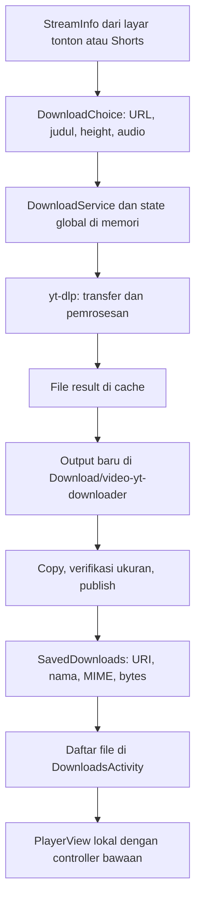

# Analisis lanjutan Unduhan dan player offline

Catatan lanjutan: laporan ini merekam snapshot sebelum implementasi. Sebagian kesenjangan telah ditangani dalam [implementasi watch video unduhan](IMPLEMENTASI_WATCH_VIDEO_UNDUHAN.md); fingerprint sumber pada evidence v3 tetap merupakan bukti snapshot analisis terdahulu.

Revisi lanjutan, 2 November 2026. Cakupan: kode FlufPlay terkini, APK `referensi/youtube-21-43-523.apk`, serta bytecode library download yang benar-benar tersimpan di cache proyek. Memakai skill leanrea dengan ekstraksi dan disassembly terarah. Tidak memakai perangkat, jaringan, instalasi, atau build aplikasi; tidak mengubah kode aplikasi.

Label bukti dalam laporan:

- **Terlihat:** ditemukan langsung pada sumber, XML/resource, atau instruksi bytecode.
- **Teruji pada parser host:** kelas parser library dijalankan di komputer dengan input sintetis; bukan pengujian download atau UI Android.
- **Usulan:** rancangan perubahan FlufPlay, bukan perilaku YouTube yang telah terbukti.
- **Belum diketahui:** belum dapat dipastikan dari jalur statis yang ditelusuri.

## 1. Kesimpulan dan pembaruan terhadap laporan sebelumnya

Penyebab ketidakmiripan mencakup model data, state download, komposisi halaman, dan pemilik kontrol player. Mengganti warna indikator atau ikon saja tidak menyelesaikannya.

| Bagian | Kondisi kode saat ini | Implikasi |
|---|---|---|
| Folder penyimpanan | Otomatis `Download/video-yt-downloader`; MediaStore pada API29+, izin legacy pada API26–28 | Pemilih folder sudah dihapus; bukan lagi masalah terbuka |
| Judul sumber | Sudah masuk `DownloadChoice` dan intent service | Koreksi laporan lama: judul tidak lagi hilang sejak awal, tetapi belum masuk state aktif/metadata persisten |
| Download aktif | `DownloadState` berisi running/message/progress/completed | Tidak ada item aktif dengan judul, thumbnail, atau identitas video |
| Progress | Callback Float dipotong menjadi Int dan dipaksa ke 0–100 | Nilai unknown berubah menjadi 0; angka transfer tidak mencakup seluruh proses |
| File selesai | Dicatat setelah copy, verifikasi, dan publish | Urutan penyimpanan ini perlu dipertahankan |
| Daftar Unduhan | Registry file URI/name/mime/bytes | Belum menjadi katalog video dengan metadata dan posisi tontonan |
| Player lokal | `PlayerView` dengan controller bawaan | Melewati kontrol khusus yang dipakai player utama |
| Watch screen lokal | Toolbar nama file dan player mengisi sisa tinggi | Melewati layout watch, metadata channel, fullscreen, dan antrean lokal |

Sumber utama: [MainActivity.kt](../flufplay/app/src/main/java/id/flufclip/player/MainActivity.kt#L441), [DownloadService.kt](../flufplay/app/src/main/java/id/flufclip/player/DownloadService.kt#L25), [DownloadsActivity.kt](../flufplay/app/src/main/java/id/flufclip/player/DownloadsActivity.kt#L79), [SavedDownloads.kt](../flufplay/app/src/main/java/id/flufclip/player/SavedDownloads.kt#L11), [DownloadDestination.kt](../flufplay/app/src/main/java/id/flufclip/player/DownloadDestination.kt). Detail perubahan folder: [FOLDER_DOWNLOAD_DEFAULT.md](FOLDER_DOWNLOAD_DEFAULT.md).

## 2. Alur yang benar-benar dijalankan FlufPlay

**Terlihat:** `startDownload` memiliki `StreamInfo`, tetapi hanya meneruskan URL, judul, height, dan audioOnly ke service. Metadata uploader/avatar, durasi, thumbnail, serta identitas video terpisah belum diteruskan.

**Terlihat:** file selesai baru masuk registry pada `DownloadService.kt:118`. Layar Unduhan merender `SavedDownloads.list`, bukan gabungan task aktif dan hasil. Itulah alasan item video yang sedang diunduh tidak muncul sebagai baris daftar.

**Terlihat:** `downloads.isEmpty()` tidak mempertimbangkan `state.running`. Download pertama dapat memiliki blok progress sekaligus empty state “Belum ada unduhan”. Ini konsekuensi cabang kode, bukan hasil observasi perangkat.

**Terlihat:** judul dipakai untuk membuat nama output, yang dibatasi 60 code point dan disanitasi. Registry menyimpan nama dokumen hasil, bukan judul video asli. Menyalin nama file kembali ke watch screen tidak dapat memulihkan judul panjang yang sudah dipotong.

## 3. Kontrak progress library sudah dipastikan

Library proyek: `io.github.junkfood02.youtubedl-android:library:0.18.1`. `classes.jar` diperiksa dengan `javap`; tidak mengasumsikan arti callback dari dokumentasi versi lain.

**Terlihat:** `YoutubeDL.execute` menerima `Function3<Float, Long, String, Unit>`. `StreamProcessExtractor.processOutputLine` mengirim:

1. hasil `getProgress(line)`;
2. hasil `getEta(line)` — ETA dalam **detik**, bukan elapsed time;
3. **baris output mentah** dari proses.

`getEta` mengubah menit × 60 + detik. Kedua field parser diawali `-1`. Parser mencari pola progress download yang mengandung persentase dan `ETA mm:ss`; jika pola tidak cocok, nilai sebelumnya dapat dipakai kembali. Baris yang cocok dengan pola FFmpeg `size=.*` menghasilkan nilai **99**, bukan hasil pengukuran persentase encoding.

**Teruji pada parser host:** kelas `StreamProcessExtractor` asli dijalankan menggunakan Java21, Kotlin stdlib 2.2.21, input berikut, dan stub `android.util.Log` minimal. Tidak menjalankan yt-dlp/FFmpeg atau menghubungi YouTube.

| Input sintetis, berurutan | progress | ETA detik | Makna yang boleh disimpulkan |
|---|---:|---:|---|
| `[youtube] Extracting URL: synthetic` | -1 | -1 | Belum ada progress/ETA yang dapat digunakan |
| `[download] 42.5% ... ETA 00:12` | 42.5 | 12 | Angka transfer pada baris yang dikenali |
| `[download] 100% ... in 00:05` | 42.5 | 12 | Contoh baris selesai ini tidak memperbarui nilai parser |
| `[download] 3.0% ... ETA 00:02` | 3.0 | 2 | Progress berikutnya dapat kembali ke angka kecil |
| `[Merger] Merging formats ...` | 3.0 | 2 | Nilai transfer/ETA lama dapat terbawa ke tahap merge |
| `size= ... time= ... bitrate= ...` | 99 | 2 | Angka 99 adalah heuristik library; ETA masih nilai lama |
| `[ExtractAudio] Destination: ...` | 99 | 2 | Bukan bukti file MP3 selesai disimpan |

Bukti lengkap: [output probe](evidence/download-parity-v3/progress-probe-output.txt), [program probe](evidence/download-parity-v3/ProgressProbe.java), [bytecode parser](evidence/download-parity-v3/StreamProcessExtractor-javap.txt), [bytecode execute](evidence/download-parity-v3/YoutubeDL-javap.txt).

### Dampaknya pada kode saat ini

**Terlihat:** callback FlufPlay memakai `progress.toInt().coerceIn(0, 100)` dan mengabaikan ETA serta baris output. Akibatnya:

- `-1` yang berarti unknown menjadi 0%, dengan indikator determinate.
- Pecahan persentase dibuang. Hal ini sendiri wajar untuk label integer, tetapi harus dilakukan setelah validasi nilai unknown.
- Untuk format video + audio terpisah, progress komponen berikutnya tidak boleh dianggap progress total yang mundur.
- Baris merge dapat mempertahankan progress transfer lama. Pesan generik “Mengunduh atau memproses…” menyembunyikan pergantian tahap.
- Setelah execute selesai, copy hasil memakai indikator tanpa persentase. Service sebenarnya menghitung `count` byte, tetapi belum menerbitkannya ke UI.
- `update()` memanggil notification manager setiap callback. Tidak ada pembatas frekuensi eksplisit; StateFlow dapat menggabungkan state yang sama, tetapi pemanggilan `notify()` tetap dilakukan. Beban aktual belum diukur.

**Usulan kontrak progress:** pisahkan `phase`, `phaseFraction?`, `bytesDone?`, `bytesTotal?`, `etaSeconds?`, dan penanda komponen transfer. `null` berarti tidak diketahui. Reset ETA saat pindah fase. Jangan memaksa progress total naik dengan bobot video/audio 50:50 atau angka 95/99 yang tidak berasal dari ukuran kerja yang diketahui. Persentase dapat berlabel “Mengunduh video/audio”; merge menampilkan status pemrosesan; copy memakai byte count yang sudah tersedia. Status selesai baru muncul setelah publish dan pencatatan berhasil.

Parsing baris output perlu toleran terhadap perubahan format. Usulan interval UI/notification 250–500ms adalah pilihan implementasi, bukan angka yang ditemukan pada YouTube.

## 4. APK referensi: status benar-benar terhubung ke item video

Analisis sebelumnya baru membuktikan keberadaan layout dan progress ring. Sekarang ditemukan pengikat layout dan perubahan statusnya.

### 4.1 Presenter dan progress view

**Terlihat:** kelas obfuscated `nra`, `classes4.dex`, constructor pada offset `0x4068fc`, memakai layout ID `0x7f0e052b` (`offline_video_item`), mencari judul, metadata, thumbnail, menu, `OfflineArrowView`, dan stub resume. Log di metode `b` menyebut nama sumber **`OfflineVideoPresenter.java`** serta fungsi **`decorateViewWithStatus`**. Ini menghubungkan layout dengan presenter yang mengolah status video offline, bukan sekadar aset yang tidak diketahui pemakainya.

**Terlihat:** `nra.b(nhl)` membaca `nhl.s` bertipe enum `aqqk`, mengubah alpha thumbnail, visibility teks dan indikator, lalu memilih metode ikon/animasi sesuai status. Cabang `PLAYABLE` mengembalikan alpha thumbnail menjadi 1 dan menyembunyikan indikator download. Cabang ordinal 3 memanggil `OfflineArrowView.j()`; ordinal 4 memanggil `k()`; ordinal 10 memakai `ic_offline_paused`. Visibility akhir pada semua konfigurasi masih dipengaruhi data/flag lain di metode itu.

**Terlihat:** `OfflineArrowView.d(int)` pada code offset `0x2d30d0` memanggil `setMax(100)` dan `setProgress(input)`. Initializer menyiapkan progress determinate dan indeterminate. `j()` memiliki cabang Lottie serta fallback AnimationDrawable; `e()` mengatur tint sesuai atribut/state. Karena itu, satu drawable ring yang diberi warna tetap belum mencakup seluruh perilaku view ini.

Bukti: [nra](evidence/download-parity-v3/nra-dex.txt), [nqv](evidence/download-parity-v3/nqv-dex.txt), [OfflineArrowView](evidence/download-parity-v2/OfflineArrowView-dex.txt).

### 4.2 Enum status yang ditemukan

**Terlihat:** `aqqk` di `classes6.dex` memiliki nama enum berikut pada `<clinit>`:

| Kelompok | Contoh nama yang benar-benar ditemukan |
|---|---|
| Ketersediaan | `DELETED`, `PLAYABLE`, `CANDIDATE` |
| Transfer | `TRANSFER_IN_PROGRESS`, `TRANSFER_WAITING_IN_QUEUE`, `TRANSFER_PAUSED` |
| Menunggu syarat | `TRANSFER_PENDING_USER_APPROVAL`, `TRANSFER_PENDING_NETWORK`, `TRANSFER_PENDING_WIFI`, `TRANSFER_PENDING_STORAGE` |
| Sebagian data tersedia | `OFFLINE_IN_PROGRESS_VIDEO_PARTIALLY_PLAYABLE` |
| Gagal | `ERROR_STREAMS_MISSING`, `ERROR_NOT_PLAYABLE`, `ERROR_POLICY`, `ERROR_EXPIRED`, `ERROR_NETWORK`, `ERROR_DISK`, `ERROR_DISK_SD_CARD`, `ERROR_GENERIC` |

Enum juga memuat `TRANSFER_PENDING_TOOTHFAIRY`; arti syarat internal tersebut belum diketahui dan tidak diterjemahkan menjadi fitur aplikasi. `ERROR_EXPIRED_RENTAL` dan `ERROR_PENDING_PLAYABILITY_ACTION` juga ada, tetapi mekanisme lisensi/otorisasi tidak dianalisis di sini.

Pada constructor enum, ordinal 3 = `TRANSFER_IN_PROGRESS`, 4 = `TRANSFER_WAITING_IN_QUEUE`, 10 = `TRANSFER_PAUSED`. Pemetaan ini menjelaskan pilihan visual presenter di atas. Bukti: [aqqk](evidence/download-parity-v3/aqqk-dex.txt).

**Batas kesimpulan:** adanya enum partial-playable tidak membuktikan semua download dapat diputar sebelum selesai. FlufPlay saat ini membutuhkan hasil video/audio yang sudah digabung atau MP3 yang sudah diekstrak. Menambahkan tombol Play pada file parsial bukan perubahan UI sederhana. Begitu pula ikon Pause tidak dapat disamakan dengan Cancel: FlufPlay belum mempertahankan task/part file untuk resume transfer.

## 5. Jalur klik item offline menuju watch command

**Terlihat, penelusuran lebih jauh daripada laporan awal:**

1. `nra.onClick(View)`, code offset `0x34196c`, mengambil ID dari snapshot `nhl.a`, mengakses data melalui `ris.d`, dan memasang callback `nln` dengan discriminator 8.
2. Cabang callback tersebut memeriksa status `PLAYABLE`/flag snapshot dan memilih callback `nqy` atau `nqz` untuk jalur terkait.
3. `nqy.a(Object)`, code offset `0x369e0c`, memanggil pembentuk command `pxr.O` atau `asbq.m`, lalu `aksq.a(bdso)`. Log menyebut **`createOfflineWatchCommandWithPlayableVideoAsync`** dari `OfflineVideoPresenter.java`.
4. `nqz.a(Object)`, code offset `0x336ffc`, juga menyusun dan mengirim command; terdapat perhitungan melalui `nhp.a(snapshot)` dan `aqzt.f(long,long)`. Arti pasti seluruh parameter belum dipetakan.

Bukti: [presenter](evidence/download-parity-v3/nra-dex.txt), [switch discriminator 8 yang diverifikasi](evidence/download-parity-v3/click-switch-verification.json), [callback perantara](evidence/download-parity-v3/nln-dex.txt), [nqy](evidence/download-parity-v3/nqy-dex.txt), [nqz](evidence/download-parity-v3/nqz-dex.txt).

**Kesimpulan yang didukung:** klik item offline mempunyai jalur watch command internal dan bergantung pada snapshot/status, bukan sekadar ACTION_VIEW menuju pemutar eksternal. **Belum diketahui:** dispatcher akhir sampai jenis container player tertentu, seluruh aturan autoplay/list, dan media controls yang aktif untuk setiap konfigurasi. Jangan mengklaim sudah membuktikan keseluruhan UI runtime YouTube dari jalur command ini saja.

## 6. Geometri daftar dan progress tontonan

**Terlihat dari resource:**

| Elemen | Default | Varian yang ditemukan |
|---|---|---|
| Lebar thumbnail | 128dp | land 172dp; sw600 262dp; sw720 292dp; sw600-land 192dp; sw720-land 262dp |
| Padding horizontal item | 16dp | sw600 24dp |
| Jarak thumbnail ke teks | 10dp | Dari layout default |
| Padding bawah item | 10dp | Dari layout default |
| Judul | Maksimum dua baris; 14sp melalui alias | sw600 18sp setelah resolusi alias |
| Teks author/sekunder | 12sp melalui alias | sw600 16sp setelah resolusi alias |
| Progress ring | innerRadius 8dp | Thickness mengacu pada stroke expanded → size2 = 2dp |
| Warna ring bawaan | `offline_progress_bar_color → yt_dark_blue → #065FD4` | Ini rantai resource, bukan jaminan tint akhir seluruh tema |

**Terlihat:** `resume_playback_overlay` (`res/roB.xml`) ternyata benar-benar **ProgressBar**, bukan hanya nama layout yang mengandung “resume”. ProgressBar mengisi lebar thumbnail, memakai drawable progress khusus, dan awalnya GONE. Ini bukti adanya progress tontonan terpisah dari ring download. Kapan view itu ditampilkan dan nilai yang dipasang memerlukan pemeriksaan binder lebih lanjut; tidak dianggap selalu terlihat.

FlufPlay sudah membaca posisi lokal, tetapi belum menyimpan durasi dalam registry atau merender bar posisi pada daftar. Durasi untuk bar perlu diambil/dipersistenkan dari media; posisi absolut saja belum cukup untuk menentukan fraksi.

Bukti: [resource dan alias](evidence/download-parity-v3/resource-dimensions-and-colors.txt), [resume ProgressBar](evidence/download-parity-v3/resume_playback_overlay.txt), [layout item](evidence/download-parity-v2/offline_video_item.txt).

## 7. Player offline: apa yang bisa dipakai ulang dan apa yang belum

### 7.1 Penyebab visual berbeda sudah pasti

**Terlihat:** [DownloadsActivity.kt:174](../flufplay/app/src/main/java/id/flufclip/player/DownloadsActivity.kt#L174) hanya memasang player ke `PlayerView`, dengan controller native tetap aktif. Tidak ada `PlayerControlsOverlay`, fullscreen handler, atau halaman metadata watch. Player mengisi sisa tinggi melalui `weight(1f)`.

Layar utama memakai [PlayerControlsOverlay](../flufplay/app/src/main/java/id/flufclip/player/PlayerControls.kt#L114) dari [MainActivity.kt:2227](../flufplay/app/src/main/java/id/flufclip/player/MainActivity.kt#L2227). Overlay sudah mempunyai ikon referensi, time bar merah, play/pause/replay, gesture seek, precise scrubbing, serta callback settings/fullscreen. `setFullscreen` di MainActivity juga mengubah orientasi dan system bars; manifest `configChanges` saja tidak melakukan hal tersebut.

### 7.2 Tidak cukup mengganti satu pemanggilan composable

**Terlihat:** `WatchScreen` bersifat private dan menerima `StreamInfo`, comments/chat state, rekomendasi `StreamInfoItem`, channel uploads, serta callback engagement. Membuka video lokal melalui `openUrl`/resolve online hanya untuk memperoleh `StreamInfo` akan merusak syarat pemutaran offline.

**Usulan:** pisahkan metadata tampilan watch dari data extractor: judul, uploader, avatar lokal opsional, durasi, info file, dan source key. Player host menerima URI lokal atau sumber online secara terpisah. Pakai ulang overlay terlebih dahulu; ekstrak komposisi metadata/layout yang dapat dipakai keduanya. Jangan membuat `StreamInfo` palsu atau memuat komentar/rekomendasi online untuk menampilkan file.

| Kontrol/fitur | Sumber kemampuan offline yang diperlukan |
|---|---|
| Play/pause/replay/seek dan speed | ExoPlayer lokal, posisi/durasi aktual |
| Fullscreen | State layar + orientasi/system bars + prioritas Back |
| Previous/next/autoplay | Antrean file lokal yang tersedia; callback bukan no-op |
| Kualitas | Resolusi/track aktual file. Batas request 720p bukan bukti hasil aktual 720p |
| Audio | Track yang benar-benar ada dalam file; jangan menjanjikan dub online yang tidak diunduh |
| CC | Track teks embedded atau subtitle lokal yang tersimpan; tidak boleh membutuhkan unduhan subtitle baru |
| Chapter/storyboard | Metadata yang dipersistenkan. Saat tidak ada, jangan mengambil storyboard online |
| Cast dan aksi online | Tampilkan hanya jika implementasinya tersedia; jangan menyambungkan tombol ke callback kosong |

**Terlihat:** overlay saat ini selalu merender toggle autoplay dan tombol CC, walaupun CC dapat diredupkan; `onCast` dan fullscreen actions bersifat opsional. Karena itu, perlu kontrak capability/visibility, bukan hanya mengisi semua parameter dengan false atau lambda kosong.

**Terlihat:** `PlayerSettings.load` dipanggil di `MainActivity.onCreate`, sedangkan notifikasi dapat langsung membuka `DownloadsActivity`. Bila overlay dipakai ulang, preferensi seek perlu dimuat juga pada jalur cold start offline; jangan bergantung pada activity utama sudah pernah dibuka dalam proses tersebut.

**Usulan ownership:** satu instance ExoPlayer untuk item aktif, dimiliki route/controller di atas subtree inline/fullscreen/miniplayer. Perpindahan mode jangan membuat ulang player dan listener. Prioritas Back: overlay/menu → settings → keluar fullscreen → kembali daftar/miniplayer → keluar Unduhan. Miniplayer offline belum ada saat ini; jangan menyebut fitur itu selesai hanya karena overlay berhasil dipasang.

## 8. Persistensi, file hilang, dan lifecycle yang ikut memengaruhi UI

Temuan berikut langsung berasal dari struktur kode; dampak runtime belum diuji pada Android.

- **Task aktif tidak persisten.** `DownloadStatus` hanya StateFlow global di memori; service mengembalikan START_NOT_STICKY. Setelah proses mati, aplikasi tidak punya record task aktif untuk merekonstruksi status interrupted. `finally` membersihkan output pada exception normal, tetapi tidak menjamin cleanup ketika proses dihentikan paksa.
- **Identitas file bukan identitas video.** Registry memakai URI sebagai key. Satu video bisa diunduh dua kualitas/format dengan URI berbeda. Perlu membedakan `downloadId`, `sourceVideoKey`, dan `outputUri`; memakai salah satunya untuk semua tujuan menimbulkan pencampuran status/duplikasi.
- **Pembacaan registry membungkus seluruh daftar dalam satu runCatching.** Satu item dengan field wajib hilang atau format salah dapat membuat seluruh daftar dikembalikan kosong. Metadata baru harus opsional, dan kegagalan satu row sebaiknya tidak menutupi row lain.
- **Daftar tidak memeriksa ulang file pada resume.** `remember(state.completed)` hanya menyegarkan registry ketika completed berubah. Menghapus/memindah file lewat aplikasi File tidak otomatis memperbarui tampilan baris. Saat ini kegagalan baru dijelaskan pada player, dan alasan error digabung menjadi pesan umum.
- **Posisi tersimpan hanya angka milidetik per URI.** Disimpan saat onStop/onDispose, belum menjadi state observabel untuk daftar dan tidak memanggil WatchHistory seperti jalur online. Perlu kebijakan replay ketika file telah selesai ditonton serta validasi posisi terhadap durasi.
- **Thumbnail sudah dibatasi dengan baik:** satu retriever pada IO, scaled frame 256×144, cache 12 gambar; API26 memakai fallback. Pertahankan batas ini. URI tidak valid menghasilkan fallback, tetapi belum menjadi status file unavailable pada row.
- **Copy final membutuhkan ruang tambahan.** Saat copy berlangsung, file hasil di cache dan output baru hidup bersamaan; untuk file N byte, fase ini dapat membutuhkan mendekati 2N byte untuk kedua salinan. Ini estimasi dari alur file, bukan pengukuran seluruh peak yt-dlp/FFmpeg. Pesan kegagalan storage perlu dibedakan dari gagal jaringan.

## 9. Kontrak data dan state yang disarankan

Bagian ini adalah **usulan implementasi**, bukan schema internal YouTube.

| Data | Field minimum | Alasan |
|---|---|---|
| Identitas | `downloadId`, `sourceVideoKey?`, `sourceUrl?`, `createdAt` | Task, video, dan file tidak tertukar; record lama boleh tanpa source |
| Metadata tampilan | `originalTitle?`, `uploader?`, `thumbnailLocalUri?`, `durationMs?` | Baris download aktif dan watch offline tanpa resolve online |
| Pilihan/hasil | `requestedHeight?`, `actualWidth?`, `actualHeight?`, `audioOnly`, `mime` | Membedakan pilihan maksimum dari kualitas file sebenarnya |
| Progress | `phase`, `phaseFraction?`, `bytesDone?`, `bytesTotal?`, `etaSeconds?` | Mendukung unknown dan perpindahan tahap yang jujur |
| Output | `outputUri?`, `displayName`, `bytes?`, `completedAt?` | Hanya COMPLETED yang boleh diputar sebagai hasil final |
| Lifecycle | `lastErrorCategory?`, `lastUpdatedAt`, `positionMs`, `finishedWatching` | Retry, file unavailable, resume, dan tampilan daftar |

State minimum yang sesuai pipeline saat ini:

`PREPARING → TRANSFERRING → PROCESSING → COPYING → VERIFYING/PUBLISHING → COMPLETED`

Jalur keluar: `CANCELLED` atau `FAILED`; saat rekonsiliasi startup, task yang ditinggal proses dapat ditandai `INTERRUPTED`. Fase processing boleh dilewati untuk format yang tidak membutuhkannya. Unknown progress tetap null. Tidak perlu menyalin seluruh enum YouTube, fitur rental, atau pause/network scheduler yang belum diimplementasikan.

**Usulan persistensi:** perluas registry dengan schemaVersion dan field opsional; pertahankan URI/name/mime/bytes milik record lama. Dengan satu task aktif, belum ada bukti bahwa harus menambah Room/WorkManager hanya untuk memperbaiki tampilan. Pemilihan storage/scheduler ditentukan kebutuhan queue/resume berikutnya, bukan kemiripan visual semata.

**Usulan presentasi:** satu komponen row untuk task aktif dan file selesai. Sebelum selesai, gunakan thumbnail yang sudah tersedia dari metadata dan ring/status. Setelah selesai, pakai thumbnail lokal dan badge downloaded; posisi tontonan menjadi bar terpisah. Selama ada task aktif, empty state tidak ditampilkan. Aksi Unduh di watch harus melihat task/video key yang sama dengan daftar, bukan hanya global running.

## 10. Urutan pengerjaan dan kriteria penerimaan

| Tahap | Perubahan yang dapat direview terpisah | Kriteria selesai |
|---|---|---|
| A — data dan status | DTO metadata, identitas task/video, phase adapter callback, migrasi row lama | Item aktif memiliki identitas; unknown tidak menjadi 0%; merge/copy tidak disebut selesai |
| B — layar Unduhan | Row aktif/selesai bersama, dimensi responsif, badge, menu, progress tontonan | Download pertama tidak menampilkan empty state; baris memiliki judul asli dan status yang konsisten |
| C — watch lokal | Surface tanpa native controls, overlay utama, metadata watch, settings/fullscreen lokal | Play/seek/speed/fullscreen bekerja dari URI lokal; tidak perlu resolve jaringan |
| D — lifecycle dan parity tambahan | Rekonsiliasi interrupted, status file hilang, queue lokal/miniplayer jika dipilih | Back/recreate tidak menggandakan player; tombol hanya tampil bila aksinya tersedia |

Kasus verifikasi yang diperlukan saat implementasi, tanpa menganggapnya telah lolos sekarang:

1. Metadata/unknown callback, progress transfer kedua, baris 100% tanpa ETA, merge, FFmpeg heuristic 99, dan ETA stale.
2. Copy byte count, pembatalan saat copy, kegagalan publish/registry, lalu hanya output milik task tersebut yang dibersihkan.
3. Registry campuran versi lama/baru dan satu row rusak; URI lama tidak diubah.
4. Download pertama, gagal/batal lalu retry, serta video sama dalam dua format/kualitas.
5. File hilang/tidak bisa dibaca ketika daftar sudah terbuka; perubahan posisi tontonan memperbarui row.
6. Player offline cold start, seek preference, media ended/replay, back dari fullscreen/settings, dan pergantian item lokal.
7. Track audio/CC/quality yang benar-benar tersedia, tanpa tombol no-op atau klaim resolusi yang hanya berasal dari request.
8. Evaluasi portrait/tablet/landscape dan hubungan download ring, badge, serta watched progress. Pemeriksaan statis saja tidak membuktikan kesamaan visual akhir.

## 11. Bukti, reproducibility, dan batas analisis

Bukti tambahan ada di [evidence/download-parity-v3](evidence/download-parity-v3/); bukti XML awal tetap di [v2](evidence/download-parity-v2/). Fingerprint sumber aplikasi dicatat untuk memastikan tahap ini hanya mengubah laporan/evidence.

- APK SHA-256: `4410cf3e9a37db09e8bd0fcc2176d047284ce95192598e9118a5249194c1b84c`.
- Library 0.18.1, classes.jar SHA-256: `a72b6dd55b767fadbb65d4528c7cb814fa471c9054f094b7013577bad14d049f`.
- Inspeksi DEX: indeks class/method dibaca dengan Python; kandidat callsite kemudian diperiksa kembali melalui dexdump kelas terpilih. Kandidat mentah tidak diperlakukan sebagai bukti sebelum verifikasi instruksi.
- Tidak menjalankan JADX seluruh APK. DEX yang relevan hanya didisassembly terfilter; tidak meninggalkan daemon analisis.
- Proses bytecode/host probe dibatasi satu inti CPU, nice15, heap JVM192MiB. Probe hanya membaca input sintetis dan membuat output lokal; bukan download sungguhan.
- Tidak ada build/test suite aplikasi, instalasi, koneksi perangkat, atau perubahan kode aplikasi dalam revisi ini. Hasil 25 unit test dari perubahan folder terdahulu tidak diklaim sebagai validasi laporan atau fitur UI yang belum dibuat.

**Belum diketahui:** pemilihan varian UI server/akun, visibility akhir seluruh view, durasi/kurva animasi, dispatcher akhir watch command sampai renderer, serta kecocokan visual dan performa aktual. Temuan statis sudah cukup untuk menentukan kontrak dan urutan implementasi, tetapi tidak cukup untuk menyatakan UI sama persis dengan YouTube.
