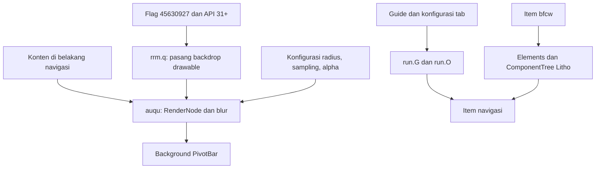

# Analisis lanjutan floating navigation YouTube

Pemeriksaan 4 November 2026, menggunakan skill leanrea pada APK Android `referensi/youtube-21-43-523.apk`. SHA-256 target: `4410cf3e9a37db09e8bd0fcc2176d047284ce95192598e9118a5249194c1b84c`.

**Hasil utama:** APK ini memang mempunyai jalur frosted background untuk PivotBar, lengkap dengan flag pengaktifan, penangkapan konten di belakang bar, blur GPU, warna lapisan, dan parameter konfigurasi. Ini temuan yang lebih spesifik daripada sekadar resource berwarna translucent. Implementasi yang menghasilkan keseluruhan kapsul floating lima tab pada gambar Android belum berhasil dicocokkan secara langsung.

Kode aplikasi FlufPlay tidak diubah dan tidak dilakukan build, instalasi, atau perubahan flag pada perangkat. Hasil ini merupakan pemeriksaan kode, resource, dan gambar referensi.

Pengguna mengklarifikasi dua acuan yang berbeda:

| Acuan | Platform menurut klarifikasi pengguna | Yang terlihat pada gambar |
|---|---|---|
| [Gambar di Xiaomi pukul 03.18](../.rea-out/navigation-ui-2026-11-04/device-images/HWKqGfNaUAAPiQt.jpeg) | Android | Lima tab berlabel: Home, Shorts, Create, Subscriptions, You; Home memakai ikon filled |
| [Postingan X](https://x.com/TOTTI6t21/status/2117588483132801211), [gambar asli postingannya](../.rea-out/navigation-ui-2026-11-04/device-images/x-original-2117588476044386305.jpg) | iOS | Empat ikon tanpa label; Home memiliki kapsul indikator terpilih di dalam kapsul utama |

**Seen:** kedua gambar itu berbeda. Gambar Android berukuran 1238 × 347 piksel, sedangkan gambar asli dari postingan X berukuran 1320 × 336 piksel. Embed resmi X berhasil dibaca melalui `publish.twitter.com/oembed`; metadata media menunjukkan foto `HWMvf98WIAE2Bmx.jpg`, bukan nama file gambar lima tab. [Catatan provenance](../.rea-out/navigation-ui-2026-11-04/device-images/x-post-provenance.json) menyimpan tautan, identitas media, dan klarifikasi platform. Postingan itu bertanggal 3 November 2026. Nomor versi aplikasi asal kedua gambar belum diketahui.

**Seen / inferred dari gambar Android:** permukaan utama berupa kapsul terang dengan ujung membulat, bayangan di bawah, dan celah terhadap indikator gesture. Ikon serta label lima item berada pada lima posisi yang berjarak hampir sama. Tidak tampak indikator kapsul terpisah di belakang Home seperti pada gambar iOS.

Pengukuran kasar pada JPEG Android dilakukan dari perubahan warna tepi, bukan dari density perangkat atau layout runtime:

| Bagian | Ukuran dalam gambar |
|---|---|
| Tepi kapsul | Kiri x ≈ 55; kanan x ≈ 1183; atas y ≈ 39; bawah y ≈ 249 |
| Lebar × tinggi | ≈ 1128 × 210 px |
| Ruang kiri / kanan | ≈ 55 px per sisi, sekitar 4,4% lebar gambar |
| Radius bila mengikuti kapsul setengah tinggi | ≈ 105 px; ini inferensi geometri |
| Lebar satu bagian bila dibagi rata lima | ≈ 225,6 px; ini inferensi pembagian |

[Catatan ukuran](../.rea-out/navigation-ui-2026-11-04/device-images/android-five-tab-geometry.json) disimpan terpisah. Angka tersebut tidak boleh langsung dipakai sebagai dp: density dan skala gambar asal belum diketahui. Tingkat blur, alpha asli, elevation, serta radius bayangan juga belum dapat ditentukan dari satu JPEG.

**Seen — jalur pemasangan frosted background sudah ditemukan.** Pada [rrb.java](../.rea-out/navigation-ui-2026-11-04/rrb.java), metode `run()`, pemasangan dikendalikan oleh:

```java
if (!aktmVar.m(126, 45630927L, false)
        || Build.VERSION.SDK_INT < 31) {
    return;
}
if (aktmVar.m(146, 45647369L, false)) {
    // Jadwalkan callback; rqv kasus 0 memanggil rrm.q().
} else {
    rrmVar.q();
}
```

Dengan demikian, flag `45630927` dan Android API 31 ke atas merupakan syarat pada jalur startup ini. Flag `45647369` memilih waktu pemasangan melalui callback, bukan bukti pengubah bentuk kapsul. [rqv.java](../.rea-out/navigation-ui-2026-11-04/rqv.java), kasus 0, meneruskan callback ke `rrm.q()`.

Pada [rrm.java](../.rea-out/navigation-ui-2026-11-04/rrm.java), metode `q()`:

- Mengambil `R.id.pivot_bar`.
- Memilih backdrop dari `next_gen_watch_container_layout` atau `watch_while_layout_coordinator_layout`, berdasarkan flag `45638138`.
- Membuat `new auqu(config, backdrop, 0.81d)`.
- Mendaftarkan pengamat untuk view backdrop dan PivotBar, yang diteruskan ke callback `rmo(auquVar, 11)`.
- Memasang drawable tersebut pada `PivotBar.p`; latar efektif juga memerlukan keadaan surface/theme `PivotBar.q` yang sesuai.

Referensi DEX yang dikonfirmasi: `rrb.run` pada `classes.dex`, `code_item 0x420100`; `rrm.q` pada `classes.dex`, `code_item 0x605ee4`; callback `rqv.a` pada `classes4.dex`, `code_item 0x483850`. [Pemindaian referensi](../.rea-out/navigation-ui-2026-11-04/navigation-xrefs.json) mengikuti batas instruksi DEX, dengan nol metode yang dihentikan karena opcode tidak didukung. Referensi utama kemudian diperiksa pada Java hasil dekompilasi.

**Seen — blur benar-benar dibuat dengan API Android.** [auqu.java](../.rea-out/navigation-ui-2026-11-04/auqu.java) membuat `RenderNode("frostedGlassRenderNode")`, menggambar backdrop ke recording canvas, menerapkan efek, lalu menambahkan lapisan warna dengan alpha. Bridge [bs$$ExternalSyntheticApiModelOutline0.java](../.rea-out/navigation-ui-2026-11-04/bs$$ExternalSyntheticApiModelOutline0.java) mengonfirmasi pemanggilan langsung ke `RenderEffect.createBlurEffect(...)` dan `RenderNode.setRenderEffect(...)`.

| Parameter | ID konfigurasi | Nilai fallback pada jalur yang diperiksa |
|---|---|---|
| Aktifkan pemasangan frosted PivotBar saat startup | `45630927` | false; juga memerlukan API ≥ 31 |
| Pilih pemasangan tertunda | `45647369` | false |
| Pilih view sumber backdrop | `45638138` | false memilih `next_gen_watch_container_layout` |
| Radius blur X/Y | `45646195` | 64 ketika nilai konfigurasi 0 |
| Skala sampling backdrop | `45646196` | 1 ketika nilai konfigurasi 0 |
| Alpha lapisan warna | `45646197` | ≈ 0,81 dari pemanggil PivotBar ketika nilai konfigurasi 0 |

Ini nilai kode, bukan pembacaan konfigurasi efektif pada akun/perangkat. Nilai 0 untuk tiga parameter terakhir diperlakukan khusus sebagai pemilihan fallback. Nilai blur 64 di sini juga bukan pengukuran radius blur pada gambar referensi.

Jalur yang ditemukan menggunakan blur dan lapisan warna. Ia belum membuktikan adanya refraksi lensa atau bahwa semua efek yang dipasarkan sebagai Liquid Glass memakai implementasi ini.

**Seen — pembentuk garis pemisah bukan pembentuk kapsul.** [afso.java](../.rea-out/navigation-ui-2026-11-04/afso.java) menggambar persegi panjang tipis pada sisi tertentu dari drawable. Pemanggilan `afso.c(48)` pada PivotBar memilih gravity TOP; angka 48 itu bukan radius sudut 48 dp. Jalur ini tidak memberikan bukti kapsul floating.

**Seen — navigasi juga mempunyai jalur renderer di luar layout tab XML.** Pada `run.O()` di [run.java](../.rea-out/navigation-ui-2026-11-04/run.java), item proto `bfcw` diteruskan ke `atry.d(...)`, kemudian `atqv.h(...)`; view hasilnya dibungkus sebagai item PivotBar.

[atry.java](../.rea-out/navigation-ui-2026-11-04/atry.java) meneruskan proto tersebut ke adapter model. [atqv.java](../.rea-out/navigation-ui-2026-11-04/atqv.java) menggunakan `com.google.android.libraries.elements.interfaces.BlockRegistryProvider`, konteks `ElementPresenter`, dan `com.facebook.litho.ComponentTree`. Metode `h(...)` membangun serta memasang ComponentTree. Jadi, memeriksa XML tab native saja belum mencakup seluruh jalur view yang bisa dimasukkan ke navigasi.

**Inferred:** renderer dinamis tersebut merupakan jalur yang layak diperiksa untuk variasi tampilan yang tidak memiliki layout XML tersendiri. Namun, yang terbukti baru kemampuan merender sebuah item PivotBar. Belum terbukti bahwa satu item tersebut berisi seluruh kapsul lima tab, atau bahwa gambar Android menggunakan jalur ini. Payload/model yang menghasilkan kapsul tersebut belum tersedia.

Temuan ini memisahkan tiga aspek yang dapat berubah secara berbeda:

| Aspek | Bukti dan status |
|---|---|
| Isi, urutan, dan jumlah tab | Model Guide, `run.G` → `run.O`; flag `45780222` melewati Subs pada navigasi fallback |
| Efek permukaan | Jalur native frosted background di atas sudah terkonfirmasi |
| Geometri floating, margin, sudut, dan bayangan | Terlihat pada gambar Android; implementasi yang persis di APK ini belum terkonfirmasi |



**Unknown:** flag atau komponen spesifik untuk membentuk kapsul Android, payload renderer terkait, geometri native dalam dp, konfigurasi yang aktif pada sumber gambar, dan versi aplikasi penghasilnya. Flag penghilangan Subs tidak boleh dianggap sebagai flag floating: fungsi yang terbukti pada `45780222` hanya mengatur penambahan Subs pada fallback.

Pembatasan analisis tetap `cpu.max = 50000 100000`, satu CPU pada affinity, `memory.max = 2147483648`, tanpa swap cgroup, dan satu worker JADX. Puncak RAM batch dekompilasi yang tercatat sepanjang investigasi sekitar 399,51 MiB; lihat [rekaman resource](../.rea-out/navigation-ui-2026-11-04/resource-usage.jsonl). JADX mencatat satu error pada kelas `atqv`; metode dan impor yang dikutip di atas tetap tersedia, sehingga klaim dibatasi pada alur yang benar-benar diperiksa.
