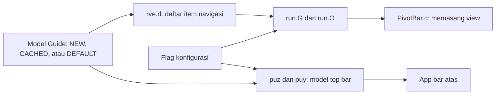

# Analisis navigasi mobile dan pembaruan UI YouTube 21.43.523

Tanggal pemeriksaan: 4 November 2026. Metode: skill [leanrea](../.agents/skills/leanrea/SKILL.md), inventaris DEX, dekompilasi kelas terpilih, dan pemeriksaan dokumentasi resmi YouTube. Kode FlufPlay tidak diubah dalam investigasi ini; tidak dilakukan build, instalasi, atau pengambilan respons memakai akun pengguna.

**Hasil utama:** APK memiliki model navigasi yang dapat diganti, pembaca flag konfigurasi, cache navigasi, serta pembaruan model app bar. Pola ini mendukung perubahan UI melalui data dan konfigurasi ketika komponen yang dibutuhkan sudah tersedia dalam APK. Perpindahan Subs ke bar atas pada Home juga sudah dijelaskan dalam dokumentasi resmi YouTube saat pemeriksaan ini.

Target yang benar-benar diperiksa:

| Identitas | Nilai |
|---|---|
| Berkas asli | `referensi/youtube-21-43-523.apk` |
| Package | `com.google.android.youtube` |
| Version name / code | `21.43.523` / `1561307650` |
| SHA-256 salinan yang diperiksa | `4410cf3e9a37db09e8bd0fcc2176d047284ce95192598e9118a5249194c1b84c` |
| Inventaris | 8 berkas DEX; hanya kelas terpilih didekompilasi |
| Bukti tersimpan | [Direktori bukti](../.rea-out/navigation-ui-2026-11-04/) |

**Seen — perubahan navigasi dalam dokumentasi resmi.** [Find your way around YouTube](https://support.google.com/youtube/answer/2398242?co=GENIE.Platform%3DAndroid&hl=en) menempatkan Subs pada bar atas di tab Home. Halaman itu juga menjelaskan Create untuk merekam, memulai live, atau mengunggah video; avatar kanan bawah membuka You. [How to explore feeds](https://support.google.com/youtube/answer/18323430?hl=en-GB) menjelaskan feed Subs, Music, Live, dan feed lain di bar atas Home.

Susunan bawah `Home · Shorts · + · You/profile` berasal dari pengamatan yang disampaikan pengguna. Investigasi ini tidak merekam ulang layar mobile atau mengambil hierarchy UI untuk mengukur susunan itu.

| Area | Penjelasan |
|---|---|
| Subs pada bar atas Home | Tujuan untuk konten terbaru dari channel yang diikuti; tetap fitur subscriptions meskipun titik masuk berpindah |
| `+` pada navigasi bawah | Create: perekaman, upload, atau live |
| `+` pada bar feed atas, bila tersedia | Membuat custom feed; fungsi berbeda dari Create. Ketersediaan custom feed memiliki syarat tersendiri menurut dokumentasi resmi |

**Seen — ada flag yang menghilangkan Subscriptions dari navigasi bawaan.** Pada [nav.java](../.rea-out/navigation-ui-2026-11-04/nav.java), metode `nav.a()` membangun model Guide bertipe DEFAULT. Kode menambahkan `FEwhat_to_watch`, `FEshorts`, kemudian secara kondisional `FEsubscriptions`, lalu `FElibrary`.

Potongan penting, disederhanakan hanya pada argumen label/ikon:

```java
// nav.a(); classes.dex, code_item offset 0x3c1c20
if (!aktmVar.m(336, 45780222L, false)) {
    hvtVar.d(naz.b("FEsubscriptions", /* label dan ikon */));
}
```

Jika pembacaan flag `45780222` menghasilkan true, blok tersebut dilewati. Jadi, APK memang sudah mendukung navigasi bawaan tanpa tab Subscriptions.

Batas kesimpulannya: ini jalur DEFAULT/fallback, bukan respons server yang sedang aktif di perangkat pengguna. Metode itu juga tidak menambahkan Create. Karena itu, flag ini tidak boleh disebut sebagai bukti tunggal yang menghasilkan keseluruhan susunan empat tombol yang pengguna lihat, ataupun sebagai ID pasti untuk seluruh rollout baru.

**Seen — jumlah dan isi tab dirender dari model.** [alog.java](../.rea-out/navigation-ui-2026-11-04/alog.java) menyimpan proto Guide `bgtx`; representasi teksnya membedakan NEW, CACHED, dan DEFAULT. [rve.java](../.rea-out/navigation-ui-2026-11-04/rve.java), metode `d(alog)`, memakai pemetaan di [rvh.java](../.rea-out/navigation-ui-2026-11-04/rvh.java) untuk mengambil daftar item PivotBar dari Guide.

Pada [run.java](../.rea-out/navigation-ui-2026-11-04/run.java):

- `G(alog)` mengganti daftar internal `V` melalui `rve.d(alogVar)`, membandingkan jumlah/model item dengan daftar sebelumnya, lalu memanggil `O(z)`.
- `O(boolean)` pada jalur pembangunan ulang membersihkan state tab sebelumnya dan mengiterasi `while (i5 < this.V.size())` untuk membentuk item baru. Ikon, label, identifier, tipe item, dan data aksi diambil dari model item.
- Item dipasang lewat `PivotBar.c(...)`, yang menambahkan item ke daftar dan memasukkan view ke hierarki. Implementasi ada di [PivotBar.java](../.rea-out/navigation-ui-2026-11-04/PivotBar.java), metode `c(avbz, boolean, int, bkij)`.

Artinya, bilah bawah bukan satu layout yang selalu harus berisi lima tombol tetap. Model yang berbeda dapat menghasilkan daftar tab berbeda menggunakan komponen native yang sudah tersedia.

**Seen — app bar atas juga menerima pembaruan model.** [puz.java](../.rea-out/navigation-ui-2026-11-04/puz.java), metode `a(alog)`, mengekstrak data dari proto Guide. [puy.java](../.rea-out/navigation-ui-2026-11-04/puy.java), metode `n(...)`, berlangganan aliran Guide/model top bar dan memilih jalur pembaruan berdasarkan flag `45718978`. Saat model tersedia, jalurnya memanggil `m(bjkc, aytk)` untuk memperbarui model tampilan. Metode `k(bjkc, aytk)` membangun view dari model tersebut.

Nama asli alur ini juga terlihat pada callback error [omw.java](../.rea-out/navigation-ui-2026-11-04/omw.java) dan [puu.java](../.rea-out/navigation-ui-2026-11-04/puu.java): `AbstractTopBarModelSupplier.autoRefreshMobileTopBarWhenNeeded`. Flag `45718978` memilih jalur pembaruan model; belum terbukti sebagai flag pemindahan Subs.



**Seen — konfigurasi dan navigasi dapat disimpan lokal.** [aktm.java](../.rea-out/navigation-ui-2026-11-04/aktm.java), metode `l(long, boolean)` dan `m(int, long, boolean)`, membaca flag berdasarkan ID atau indeks dan memakai nilai bawaan bila jalur tersebut tidak memiliki nilai. Jalur map mengakses konfigurasi melalui `aktf.c().w`; jalur terindeks menggunakan `awae`.

[alhu.java](../.rea-out/navigation-ui-2026-11-04/alhu.java) memiliki jalur baca/tulis grup konfigurasi `com.google.android.libraries.youtube.innertube.hot_config_group` dan `com.google.android.libraries.youtube.innertube.cold_config_group`, beserta timestamp/hash. [rpb.java](../.rea-out/navigation-ui-2026-11-04/rpb.java), metode `s(...)`, menyiapkan penyimpanan `commonui/pivotbar_proto.pb`. Temuan ini mendukung penggunaan konfigurasi dan model navigasi yang tersimpan; isi cache aktual perangkat tidak diperiksa.

**Inferred — mengapa UI dapat berubah tanpa setiap kali mengganti APK.** Jika komponen dan perilakunya sudah didukung client, pembaruan model Guide/renderer serta nilai flag dapat memilih susunan baru. App bar dan bilah bawah mengonsumsi model yang dapat diperbarui, sehingga titik masuk Subs dapat dipindah dan daftar bawah dipersingkat. Ini pola UI yang dikendalikan data/konfigurasi dari server dengan komponen native di client. Investigasi ini menunjukkan mekanisme client, bukan rekaman respons jaringan native untuk rollout pengguna.

[Dokumentasi eksperimen dan rollout YouTube](https://support.google.com/youtube/answer/7367023?hl=en&ref_topic=9257409) juga menjelaskan bahwa fitur bisa berbeda antar akun dan diluncurkan bertahap. Maka versi APK yang sama saja belum cukup untuk menyimpulkan UI efektif semua akun/perangkat akan sama.

**Unknown:** nilai efektif flag pada akun/perangkat pengguna; payload Guide/top bar native yang diterima; pengendali persis yang menggabungkan seluruh perubahan ini; kondisi tablet versus mobile untuk rollout tersebut. Klaim ini memerlukan respons runtime atau pemeriksaan konfigurasi perangkat yang bersangkutan.

Pembatasan resource diberlakukan melalui cgroup: `cpu.max = 50000 100000` (50% satu core), affinity satu CPU, `memory.max = 2147483648` (2 GiB), dan swap untuk proses analisis dimatikan. JADX memakai satu worker dan batas heap `1400m`. Puncak penggunaan memori cgroup pada batch dekompilasi yang dicatat adalah **399,51 MiB**. Rekaman batas dan penggunaan ada pada [resource-usage.jsonl](../.rea-out/navigation-ui-2026-11-04/resource-usage.jsonl) dan [summary.json](../.rea-out/navigation-ui-2026-11-04/summary.json).

Sebagian Java hasil dekompilasi mengandung peringatan rekonstruksi control flow. JADX mencatat satu error untuk kelas utilitas `rve`; transformasi `d(alog)` yang dipakai sebagai bukti tetap tersedia. Hasil ini dipakai untuk analisis simbol dan alur yang terlihat, bukan sebagai source siap dikompilasi atau bukti eksekusi UI.

Pemeriksaan lanjutan pada tanggal yang sama memetakan variasi tampilan tab dan mengecek kemungkinan navigasi floating dengan lima tab. Batas CPU/RAM tetap sama dan tidak dilakukan build.

**Seen — setidaknya enam layout tab native diperiksa langsung dari XML APK.** Bukti decode ada di [navigation-layouts](../.rea-out/navigation-ui-2026-11-04/navigation-layouts/), dengan [ringkasan resource dan style](../.rea-out/navigation-ui-2026-11-04/navigation-layouts/summary.json).

| Layout | Bentuk yang didukung | Bukti struktur |
|---|---|---|
| `image_only_tab` | Ikon tanpa label teks | 0 TextView pada tree layout |
| `image_with_text_tab` | Ikon dengan label | 1 TextView |
| `avatar_image_only_tab` | Avatar tanpa label | 0 TextView |
| `avatar_image_with_text_tab` | Avatar dengan label | 1 TextView |
| `avatar_clipped_image_view_with_text_tab` | Varian avatar clipped dengan label | 1 TextView |
| `avatar_image_with_text_tab_animation` | Varian layout avatar dengan label bernama animation | 1 TextView; nama ini sendiri belum membuktikan animasi aktif |

[avbz.java](../.rea-out/navigation-ui-2026-11-04/avbz.java) membuat pengendali teks bila view label tersedia. Jadi mode tanpa teks dan dengan teks merupakan layout yang benar-benar berbeda, bukan sekadar kesimpulan dari nama resource. JADX mencatat satu error pada kelas ini; struktur enam layout di atas diperiksa terpisah melalui XML APK.

**Seen — jenis perilaku item.** [bkij.java](../.rea-out/navigation-ui-2026-11-04/bkij.java) memuat `SELECT_TAB`, `UNSELECTABLE_TAB`, dan `OVERFLOW_TAB`, selain UNKNOWN. Ini membuktikan dukungan item pemilih tab, item aksi, dan overflow; bukan bukti bahwa semua jenis itu selalu muncul bersama pada UI aktif.

**Seen — style dan ukuran responsif.** Resource memuat `PivotBar.Default`, `PivotBar.Dark`, dan `PivotBar.Dark.DarkerPalette`; beberapa style menyediakan latar translucent. Ukuran resource mencakup tinggi bar 48 dp dan varian Cairo 56 dp, ikon 24 dp, mask avatar 28 dp, serta minimum lebar tab 48 dp dan 96 dp untuk `sw600dp`. Ini nilai resource, bukan pengukuran UI runtime.

**Unknown — implementasi navigasi floating dengan lima tab di APK belum terkonfirmasi.** Pemindaian terarah mencakup 33 layout container dan include, dengan bukti di [navigation-containers](../.rea-out/navigation-ui-2026-11-04/navigation-containers/). Delapan layout yang langsung memuat PivotBar memakai `layout_width = match_parent`, ditempatkan pada footer bawah selebar parent. Delapan layout lain memuat `NavigationBarDividerLayout` dan meng-include varian layout yang sudah diperiksa. Tidak ditemukan bukti spesifik berupa kapsul navigasi terpisah dari tepi layar dengan lima tab pada jalur XML tersebut. Latar translucent, kelompok ikon yang berada di tengah layar, dan kemampuan menerima lima item tidak cukup untuk menyatakan bahwa bar-nya floating.

Batas pemeriksaan ini tetap penting: perubahan LayoutParams saat runtime belum seluruhnya ditelusuri. Selain layout native, `run.O()` juga memiliki jalur item `bfcw` yang dibentuk melalui `atry.d(...)` dan `atqv.h(...)`, lalu memasukkan view hasil renderer ke PivotBar. Tampilan spesifik dari payload renderer tersebut tidak bisa ditentukan dari layout XML native saja. Karena itu, implementasi floating lima tab di APK belum terkonfirmasi, bukan dinyatakan tidak ada dalam seluruh kemungkinan UI YouTube.

**Seen — gambar referensi pengguna menunjukkan floating navigation dengan lima tab.** Atas permintaan pengguna, gambar [HWKqGfNaUAAPiQt.jpeg](../.rea-out/navigation-ui-2026-11-04/device-images/HWKqGfNaUAAPiQt.jpeg) dibaca dari `/sdcard/Pictures/` di Xiaomi `25040RP0AG`. MediaStore mencatat gambar ditambahkan pada 4 November 2026 pukul 03:18:45 WIB dan dimodifikasi 03:18:46 WIB. Ukurannya 1238 × 347 piksel. [Metadata bukti](../.rea-out/navigation-ui-2026-11-04/device-images/metadata.json) disimpan bersama gambar; berkas di perangkat tidak diubah.

Gambar memperlihatkan kapsul terang dengan ujung sangat membulat dan bayangan, dikelilingi konten di sisi atas/bawah, dengan gesture indicator terpisah di bawah. Lima item yang terlihat adalah **Home, Shorts, Create (+), Subscriptions, You**. Jadi desain floating lima tab kini terkonfirmasi secara visual pada gambar referensi tersebut.

Gambar ini belum membuktikan bahwa APK Android `21.43.523` yang diperiksa menghasilkan tampilan itu: file gambar tidak memberikan identitas versi, platform asal, konfigurasi akun, atau payload renderer pembentuknya. Kesimpulan visual dan status penelusuran implementasi APK harus tetap dibedakan.

Penelusuran lanjutan menemukan pemasangan frosted background native dengan flag `45630927`, API Android `RenderEffect`, serta jalur renderer Elements/Litho. Klarifikasi pengguna juga menetapkan bahwa gambar lima tab adalah acuan Android, sedangkan tautan X yang kemudian diberikan merupakan acuan iOS dengan empat ikon. Bukti dan pengukuran lengkap ada pada [analisis lanjutan floating navigation](ANALISIS_LANJUTAN_FLOATING_NAVIGATION_YOUTUBE.md).
