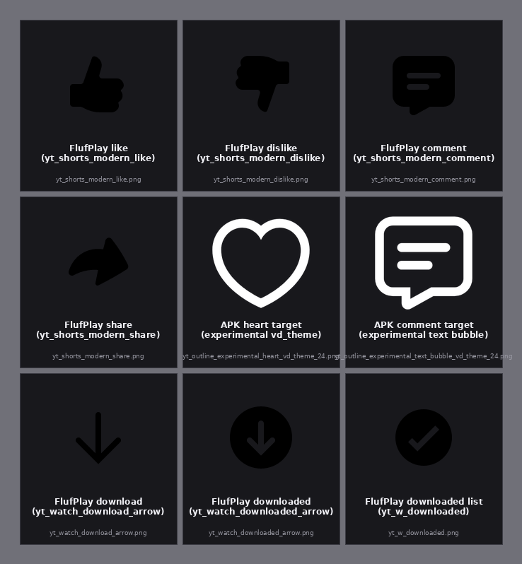
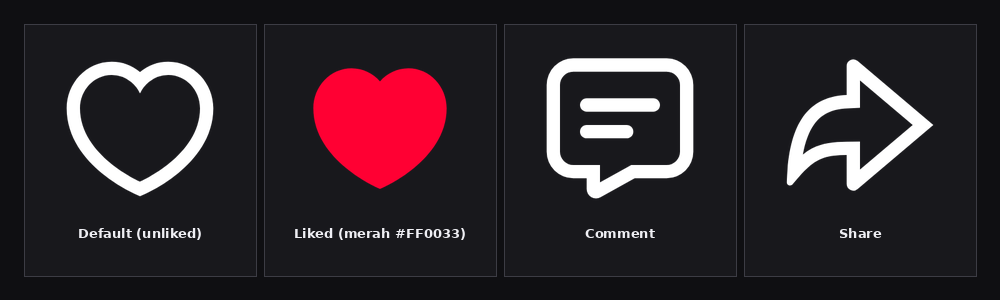

# Plan Perubahan Icon Shorts FlufPlay

Status: **diimplementasikan** 2026-11-02; verifikasi visual perangkat belum dilakukan. Rincian build ada pada bagian hasil di bawah.

**Koreksi pengguna:** ikon heart saat liked harus terisi putih, bukan merah. Kode dan vector telah disesuaikan; ketentuan warna merah di bagian rencana historis di bawah tidak lagi berlaku.

Dokumen ini merencanakan perubahan ikon kolom aksi Shorts di FlufPlay agar memakai
keluarga ikon yang benar dari APK `referensi/youtube-21-43-523.apk`. Fokus utama:
**like memakai heart** dan **comment memakai text bubble**, sesuai temuan
`referensi/ekstrak-icon-shorts/` dan koreksi pengguna. **Download sudah benar dan
tidak diubah.**

## 1. Ringkasan keputusan

| Prioritas | Slot | Kondisi sekarang | Target |
|---|---|---|---|
| P0 | Like | Thumbs-up terisi (`yt_fill_experimental_thumb_up_black_24`) | Heart outline; heart fill merah saat liked |
| P0 | Comment | Text bubble terisi (`yt_fill_experimental_text_bubble_black_24`) | Text bubble outline |
| P0 | Dislike | Ada di kolom Shorts FlufPlay (`ShortsScreen.kt:423`) | **Dihapus dari rail Shorts** — YouTube tidak menampilkan slot dislike di sini |
| P0 | Share | Filled sandbox share | `yt_outline_experimental_share_vd_theme_24` (outline) |
| — | Download watch | `yt_watch_download_arrow` / `yt_watch_downloaded_arrow` | **Tidak diubah** — sudah benar |

Alasan: pengguna melihat app YouTube memakai heart untuk like, comment memakai
text bubble, tidak ada dislike di kolom Shorts, dan share memakai outline. Dislike
di halaman tonton video biasa tetap ada dan tidak terpengaruh.

## 2. Bukti kondisi sekarang



Catatan gambar: baris "FlufPlay dislike" adalah kondisi saat ini; plan menghapus
slot itu dari rail Shorts. Gambar hanya membandingkan bentuk aset, bukan urutan
final kolom.

Semua path di bawah relatif terhadap root repo.

### 2.1 Kode yang memakai ikon

- [`ShortsScreen.kt`](../flufplay/app/src/main/java/id/flufclip/player/ShortsScreen.kt:422)
  baris 422–425 adalah satu-satunya pemakaian `yt_shorts_modern_*`:
  - Like: `yt_shorts_modern_like`, tint biru `Color(0xFF3EA6FF)` saat `rating == 1`.
  - Dislike: `yt_shorts_modern_dislike`, tint biru saat `rating == -1`. **Slot ini
    tidak ada di YouTube Shorts; plan menghapusnya.**
  - Comment: `yt_shorts_modern_comment`, tint putih.
  - Share: `yt_shorts_modern_share`, tint putih.
- [`MainActivity.kt`](../flufplay/app/src/main/java/id/flufclip/player/MainActivity.kt:2532)
  halaman tonton video biasa tetap memakai `yt_w_dislike` / `yt_w_dislike_on`;
  penghapusan slot Shorts tidak mengubah dislike di sana.
- [`ShortsScreen.kt`](../flufplay/app/src/main/java/id/flufclip/player/ShortsScreen.kt:623)
  `ShortsAction` menampilkan ikon **32 dp**, label 12 sp, kolom 64 dp, jarak 12 dp.
  Ukuran/posisi ini tidak perlu diubah.
- [`MainActivity.kt`](../flufplay/app/src/main/java/id/flufclip/player/MainActivity.kt:2390)
  tombol Download watch memakai `yt_watch_download_arrow` /
  `yt_watch_downloaded_arrow`. Ini **di luar scope**.
- [`DownloadedWatch.kt`](../flufplay/app/src/main/java/id/flufclip/player/DownloadedWatch.kt:266)
  memakai `yt_watch_downloaded_arrow`; **di luar scope**.
- [`DownloadScreens.kt`](../flufplay/app/src/main/java/id/flufclip/player/DownloadScreens.kt:175)
  memakai `yt_w_downloaded` (lingkaran centang) untuk status di daftar unduhan;
  konteks berbeda dari tombol watch, **di luar scope**.

### 2.2 Aset FlufPlay saat ini

Aset ada di lima density: `drawable-mdpi` … `drawable-xxxhdpi`, masing-masing
24/36/48/72/96 px (nominal 24 dp). File-file ini berstatus **untracked** di git
(`??`), jadi jangan `git clean` dan buat backup sebelum mengganti.

| Asset FlufPlay | Hash xxxhdpi | Identik dengan aset APK | Masalah |
|---|---|---|---|
| `yt_shorts_modern_like.png` | `c788e39f…` | `yt_fill_experimental_thumb_up_black_24` (`0x7f080f1d`, `res/5i8.png`) | Thumbs-up, bukan heart |
| `yt_shorts_modern_dislike.png` | `592a3442…` | `yt_fill_experimental_thumb_down_black_24` (`0x7f080f18`, `res/sX4.png`) | Slot dihapus dari rail Shorts; aset dibiarkan unused |
| `yt_shorts_modern_comment.png` | `a8d327fa…` | `yt_fill_experimental_text_bubble_black_24` (`0x7f080f15`, `res/s21.png`) | Bubble terisi, target outline |
| `yt_shorts_modern_share.png` | `62890eee…` | `yt_fill_experimental_sandbox_share_black_24` (`0x7f080ed4`, `res/_Bn.png`) | Filled sandbox share, target outline |

Setelah slot dislike dihapus, `yt_shorts_modern_dislike.png` menjadi **unused**.
Plan ini tidak mengganti atau menghapusnya dulu; biarkan untuk rollback dan
cleanup terpisah.

Catatan: dokumen lama
[`ANALISIS_SHORTS_YOUTUBE_FLUFPLAY.md`](ANALISIS_SHORTS_YOUTUBE_FLUFPLAY.md)
(tahap keempat) menyebut like sudah memakai heart, tetapi kode dan hash aset saat
ini membuktikan yang dipakai adalah thumbs-up. **Kode saat ini adalah sumber
kebenaran** untuk plan ini.

### 2.3 Mengapa keluarga experimental?

Registry ikon di `classes.dex` (`klq.<clinit>`) memuat keluarga
`yt_outline_experimental_*` / `yt_fill_experimental_*`, sedangkan seluruh
`youtube_shorts_*_32dp` tidak direferensikan. Rincian ada di
[`referensi/ekstrak-icon-shorts/README.md`](../referensi/ekstrak-icon-shorts/README.md).
Pilihan ini tetap **inferensi statis**, bukan bukti runtime bahwa setiap akun
memakai keluarga yang sama.

## 3. Target mapping

Target implementasi memakai bentuk vector `vd_theme` (satu file per ikon). Vector
sumber di APK berwarna putih; khusus selected heart, fillColor diubah menjadi merah
`#FF0033` di FlufPlay agar tidak pernah tampil putih. Padanan PNG `_black_24` tetap
dicatat sebagai alternatif; bentuknya identik.

| Slot | Target shape (`vd_theme`) | XML APK | Padanan PNG tintable | ID PNG | File PNG xxxhdpi | Warna final |
|---|---|---|---|---|---|---|
| Like | `yt_outline_experimental_heart_vd_theme_24` | `res/4UA.xml` | `yt_outline_experimental_heart_black_24` | `0x7f081260` | `res/bWp.png` | Putih |
| Like (selected) | `yt_fill_experimental_heart_vd_theme_24` | `res/Elg.xml` | `yt_fill_experimental_heart_black_24` | `0x7f080e5a` | `res/rJV.png` | **Merah `#FF0033`** |
| Comment | `yt_outline_experimental_text_bubble_vd_theme_24` | `res/ExG.xml` | `yt_outline_experimental_text_bubble_black_24` | `0x7f081442` | `res/CUP.png` | Putih |
| Share | `yt_outline_experimental_share_vd_theme_24` | `res/ZmA.xml` | `yt_outline_experimental_share_black_24` | `0x7f0813cd` | `res/hfO.png` | Putih |

Untuk implementasi plan ini, gunakan kolom **Target shape (`vd_theme`)**. Kolom
padanan PNG hanya alternatif bila vector tidak dipakai.

Dislike **tidak masuk mapping** karena slotnya dihapus dari rail Shorts. Dislike
di halaman tonton video biasa tetap memakai aset `yt_w_dislike` /
`yt_w_dislike_on` dan tidak berubah.

Catatan warna:
- APK `youtube_shorts_heart_on_32dp` yang merah memakai sekitar `#FF0100`; brand
  YouTube di resource lain memakai `#FF0033`. Plan ini memilih **`#FF0033`** agar
  konsisten dengan merah brand. Angka bisa disesuaikan setelah sampel visual.
- **Selected heart wajib merah.** `yt_fill_experimental_heart_vd_theme_24` di APK
  berwarna putih; jika dipakai apa adanya, hasilnya putih. Di FlufPlay,
  `yt_shorts_modern_like_on.xml` harus memakai `fillColor="#FFFF0033"` **dan** kode
  memberi `tint = Color(0xFFFF0033)` saat `rating == 1`. Jangan mengandalkan tint
  saja, dan jangan memberi tint putih pada state selected.
- `vd_theme` memakai `@android:color/white` (`0x0106000b`) langsung, bukan theme
  attr yang tidak tersedia. Untuk selected heart, fill putih itu diganti merah.



## 4. Rencana aset

### 4.1 Nama file

Gunakan vector XML di `res/drawable/` (satu file per ikon), bukan PNG per density:

| File final | Isi | Sumber XML APK |
|---|---|---|
| `yt_shorts_modern_like.xml` | Heart outline | `res/4UA.xml` |
| `yt_shorts_modern_like_on.xml` | Heart fill merah `#FF0033` | `res/Elg.xml` |
| `yt_shorts_modern_comment.xml` | Text bubble outline | `res/ExG.xml` |
| `yt_shorts_modern_share.xml` | Share outline | `res/ZmA.xml` |

Hapus PNG lama `yt_shorts_modern_{like,comment,share}.png` dari lima folder
density agar tidak menang atas vector pada density tersebut.
`yt_shorts_modern_dislike.png` tidak diganti dan menjadi unused.

Jika memilih alternatif PNG `_black_24`, file PNG tetap di lima density; itu
bukan implementasi utama plan ini.

### 4.2 Sumber ekstraksi

Decode binary XML APK menjadi vector XML teks, bukan ekstrak PNG:

| Asset FlufPlay | Resource `vd_theme` | XML APK |
|---|---|---|
| `yt_shorts_modern_like.xml` | `yt_outline_experimental_heart_vd_theme_24` | `res/4UA.xml` |
| `yt_shorts_modern_like_on.xml` | `yt_fill_experimental_heart_vd_theme_24` | `res/Elg.xml` |
| `yt_shorts_modern_comment.xml` | `yt_outline_experimental_text_bubble_vd_theme_24` | `res/ExG.xml` |
| `yt_shorts_modern_share.xml` | `yt_outline_experimental_share_vd_theme_24` | `res/ZmA.xml` |

Detail yang harus dipertahankan:

- `viewportWidth`/`viewportHeight` = 24, `width`/`height` = 24dp.
- `yt_shorts_modern_like.xml`, `yt_shorts_modern_comment.xml`, dan
  `yt_shorts_modern_share.xml`: `fillColor="@android:color/white"` (`0x0106000b`).
- `yt_shorts_modern_like_on.xml`: `fillColor="#FFFF0033"` (merah). Ini perubahan
  yang disengaja dari vector APK yang putih; tanpa ini selected heart akan putih.
- `pathData` asli; tidak perlu `<group>` atau clip-path.
- Jangan memakai SVG gallery untuk Android; Android memerlukan vector XML.

Verifikasi decode dengan `aapt2 dump xmltree` dan build Gradle, bukan hanya
membandingkan gambar PNG.

### 4.3 Backup dan konflik resource

Sebelum menimpa, simpan aset yang akan diganti
(`yt_shorts_modern_{like,comment,share}.png`) dari lima density ke folder backup
di luar `res/`, misalnya `flufplay/.verification/icon-backup-2026-11-02/`. Ikutkan
`yt_shorts_modern_dislike.png` bila ingin rollback penuh. File lama tidak tracked
git, jadi tanpa backup perubahan tidak bisa di-rollback lewat git.

Setelah XML baru ditambahkan, hapus PNG like/comment/share dari semua density.
Jangan meninggalkan PNG dengan nama resource yang sama karena resource PNG density
akan menang atas vector dan membuat perubahan tidak terlihat.

## 5. Rencana perubahan kode

File **kode** yang disentuh hanya
[`ShortsScreen.kt`](../flufplay/app/src/main/java/id/flufclip/player/ShortsScreen.kt)
di sekitar baris 422–425 (cari blok `Column(Modifier.align(Alignment.BottomEnd)`).

### 5.1 Like

`yt_shorts_modern_like_on.xml` sudah berisi merah `#FFFF0033`; kode tetap memberi
tint merah agar selected tidak mungkin tampil putih.

```kotlin
ShortsAction(
    if (rating == 1) R.drawable.yt_shorts_modern_like_on else R.drawable.yt_shorts_modern_like,
    if (info != null && info.likeCount >= 0) formatCount(info.likeCount + if (rating == 1) 1 else 0) else "Like",
    "Like",
    tint = if (rating == 1) Color(0xFFFF0033) else Color.White,
) { info?.let { onRate(it, 1) } }
```

Jangan mengganti tint selected menjadi `Color.White` atau `Color.Unspecified`.
Jika XML selected masih putih dan tint tidak terapan, heart akan tampil putih.

### 5.2 Hapus slot dislike

Hapus seluruh `ShortsAction(... yt_shorts_modern_dislike ...)` dari kolom Shorts.
Jangan menggantinya dengan ikon lain. `onRate(it, -1)` tetap dipakai di halaman
tonton video biasa; tidak ada pemanggilan dislike dari Shorts setelah perubahan.

### 5.3 Comment dan share

Nama resource tetap; XML vector baru memakai nama yang sama, jadi kode tidak
berubah. Share sekarang menunjuk ke vector
`yt_outline_experimental_share_vd_theme_24`.

```kotlin
ShortsAction(R.drawable.yt_shorts_modern_comment, commentCount?.let { formatCount(it.toLong()) } ?: "Comments", "Comments", tint = Color.White) { info?.let(onComments) }
ShortsAction(R.drawable.yt_shorts_modern_share, "Share", "Share", tint = Color.White) { info?.let(onShare) }
```

### 5.4 Yang tidak diubah

- `ShortsAction` 32 dp, label 12 sp, kolom 64 dp, spacing 12 dp.
- Semua kode download:
  - `MainActivity.kt:2390`
  - `DownloadedWatch.kt:266`
  - `DownloadScreens.kt:175`
  - `ShortsScreen.kt:438` (tombol unduh state paused)
- `yt_short_*` (like_off/on, comment_shadowed, dll.) yang saat ini tidak dipakai
  kode; jangan dipakai di plan ini. Cleanup aset orphan bisa jadi pekerjaan terpisah.

## 6. Verifikasi

### 6.1 Build

Gunakan build yang dibatasi resource seperti praktik sebelumnya, misalnya:

```bash
cd flufplay
taskset -c 0 nice -n 15 ./gradlew :app:assembleDebug \
  -Dorg.gradle.workers.max=1 --no-daemon
```

Jika lingkungan normal, `./gradlew :app:assembleDebug` cukup. Catat hasil build,
`git diff --check`, dan pastikan tidak ada file lain yang berubah.

### 6.2 Matriks visual

| Kondisi | Hasil yang diharapkan |
|---|---|
| Shorts belum di-like | Heart outline putih; jumlah like tidak berubah |
| Shorts di-like | Heart fill **merah `#FF0033`**, bukan putih/biru; jumlah +1; tap lagi kembali outline |
| Slot dislike | Tidak ada di kolom Shorts |
| Comment | Text bubble outline putih; jumlah komentar tetap |
| Share | Share outline putih; aksi share tetap |
| Download chip | Tetap `yt_watch_download_arrow` → `yt_watch_downloaded_arrow`; tidak berubah |
| Daftar unduhan | Tetap `yt_w_downloaded` (check circle); tidak berubah |

### 6.3 Pemeriksaan aset

- Empat XML vector ada di `res/drawable/`: like, like_on, comment, share.
- `yt_shorts_modern_like_on.xml` memakai fillColor merah `#FFFF0033`; like,
  comment, dan share memakai `@android:color/white`.
- PNG lama like/comment/share sudah dihapus dari semua folder density; tidak ada
  konflik nama resource. PNG dislike boleh tetap sebagai unused.
- Render 32 dp: outline putih, liked merah, comment/share putih.
- Bandingkan dengan gallery `referensi/ekstrak-icon-shorts/png/` dan preview
  target `docs/evidence/shorts-icon-plan/target-states.png`.

### 6.4 Batas verifikasi

Semua pemetaan ikon berasal dari analisis statis registry `classes.dex` dan
perbandingan visual APK, bukan runtime YouTube. Uji perangkat/emulator tetap
diperlukan sebelum mengklaim paritas penuh. Catat hasil screenshot dan density
perangkat.

## 7. Acceptance criteria

- [ ] Tidak ada thumbs-up di kolom aksi Shorts.
- [ ] Like default = heart outline putih.
- [ ] Liked = heart fill **merah `#FF0033`**, bukan putih atau biru.
- [ ] Comment = text bubble outline, bukan bubble terisi.
- [ ] Tidak ada slot dislike di rail Shorts.
- [ ] Share = `yt_outline_experimental_share_vd_theme_24` (outline), bukan filled sandbox share.
- [ ] Download watch/downloaded dan daftar unduhan tidak berubah.
- [ ] Build sukses; hanya file ikon + `ShortsScreen.kt` yang berubah.
- [ ] Screenshot default/liked/comment/share sesuai target.

## 8. Risiko dan keputusan yang masih terbuka

1. **Bentuk heart.** Ada beberapa heart di APK: experimental, Delhi, dan
   `youtube_shorts_heart_*_32dp`. Plan memilih experimental karena satu-satunya
   keluarga heart yang terdaftar di registry ikon. Perlu konfirmasi visual.
2. **Liked heart bisa putih jika salah implementasi.** `yt_fill_experimental_heart_vd_theme_24`
   aslinya putih. Mitigasi wajib: `yt_shorts_modern_like_on.xml` memakai
   `fillColor="#FFFF0033"` dan kode memberi tint merah. Jangan memberi tint putih
   pada state selected.
3. **Vector vs PNG/konflik resource.** Plan memakai vector XML; PNG like/comment/share
   lama harus dihapus agar tidak menang atas vector. Decode XML harus mempertahankan
   `pathData` dan `fillColor` yang benar.
4. **Arah share di RTL.** Vector bisa memakai `autoMirrored`; alternatif PNG tidak
   otomatis mirror. Jika RTL penting, tambahkan penanganan terpisah.
5. **Server-driven UI.** APK dapat memilih keluarga ikon lewat server/experiment;
   registry hanya bukti resource yang tersedia.
6. **Banyak perubahan lokal.** `git status` FlufPlay menunjukkan banyak file
   modified/untracked. Jangan menyentuh file di luar scope dan jangan menjalankan
   `git clean`.
7. **Penghapusan dislike.** Pastikan tidak ada lagi referensi
   `yt_shorts_modern_dislike` di `ShortsScreen.kt`; dislike halaman tonton biasa
   (`yt_w_dislike`) tetap dipakai dan perlu diuji sebagai regresi.

## 9. Urutan implementasi yang disarankan

1. Backup PNG like/comment/share (dan dislike bila ingin rollback penuh) dari lima
   density.
2. Decode empat vector `vd_theme` dari APK. Ubah `fillColor` pada
   `yt_shorts_modern_like_on.xml` menjadi `#FFFF0033` (merah).
3. Verifikasi vector: 24dp, `pathData` asli, like/comment/share putih, like_on merah,
   tidak ada theme attr yang tidak tersedia.
4. Tambah XML ke `res/drawable/`; hapus PNG like/comment/share dari semua density.
5. Edit `ShortsScreen.kt`: hapus blok dislike, pilih `_on` + tint merah untuk liked,
   comment/share memakai nama resource yang sama (vector).
6. Build terbatas + screenshot default/liked/comment/share. Pastikan liked **merah**,
   bukan putih/biru.
7. Perbarui dokumentasi:
   - `ANALISIS_SHORTS_YOUTUBE_FLUFPLAY.md` (koreksi tahap keempat: heart benar-benar
     dipakai, bukan thumbs-up; tidak ada dislike di rail Shorts).
   - `PERBAIKAN_SHORTS_DAN_UNDUHAN_2026-11-02.md` (pilihan implementasi ikon).
   - `referensi/ekstrak-icon-shorts/README.md` bila perlu.
8. Commit terpisah untuk aset + kode; jangan gabung dengan perubahan download yang
   sudah ada.

## 10. Rollback

- Restore PNG like/comment/share dari backup, lalu hapus XML
  `yt_shorts_modern_{like,like_on,comment,share}.xml`.
- Kembalikan `ShortsScreen.kt` ke kondisi sekarang: like memakai
  `yt_shorts_modern_like` dengan tint biru, blok dislike dipasang lagi, comment/share
  memakai PNG lama.
- `yt_shorts_modern_dislike.png` tidak tersentuh, jadi tidak perlu restore.
- Download tidak tersentuh, jadi tidak ada rollback download.

## 11. Referensi

- [`docs/PERBAIKAN_SHORTS_DAN_UNDUHAN_2026-11-02.md`](PERBAIKAN_SHORTS_DAN_UNDUHAN_2026-11-02.md)
- [`docs/ANALISIS_SHORTS_YOUTUBE_FLUFPLAY.md`](ANALISIS_SHORTS_YOUTUBE_FLUFPLAY.md)
- [`docs/ANALISIS_IKON_ACTION_DOWNLOAD_YOUTUBE.md`](ANALISIS_IKON_ACTION_DOWNLOAD_YOUTUBE.md)
- [`referensi/ekstrak-icon-shorts/README.md`](../referensi/ekstrak-icon-shorts/README.md)
- `referensi/ekstrak-icon-shorts/manifest.tsv`
- `.rea-out/resources.txt` dan `.rea-out/dex/classes.dex.dis.txt` (registry `klq.<clinit>`)
- [`flufplay/app/src/main/java/id/flufclip/player/ShortsScreen.kt`](../flufplay/app/src/main/java/id/flufclip/player/ShortsScreen.kt:422)
- [`flufplay/app/src/main/java/id/flufclip/player/MainActivity.kt`](../flufplay/app/src/main/java/id/flufclip/player/MainActivity.kt:2390)

## 12. Hasil implementasi

- Empat vector diambil dari `pathData` APK menggunakan `aapt2 dump xmltree`; heart aktif memakai fill dan tint `#FF0033`. PNG lama dicadangkan di `flufplay/.verification/shorts-icon-backup-20261102-191236/`.
- Rail Shorts memakai heart, comment outline, share outline, tanpa dislike. Ikon unduhan tidak diubah.
- Tidak ada pengujian perangkat atau screenshot baru; kesesuaian visual dan interaksi runtime belum terverifikasi.
- Build `:app:assembleDebug` offline berhasil (1 worker, 1 CPU, Java 21); `git diff --check` bersih. Peringatan deprecation/SDK yang ada tetap muncul.
- Commit terpisah belum dibuat: `ShortsScreen.kt` berisi banyak perubahan lokal lain yang sudah ada, sehingga commit seluruh file akan mengikutsertakan pekerjaan di luar cakupan.
